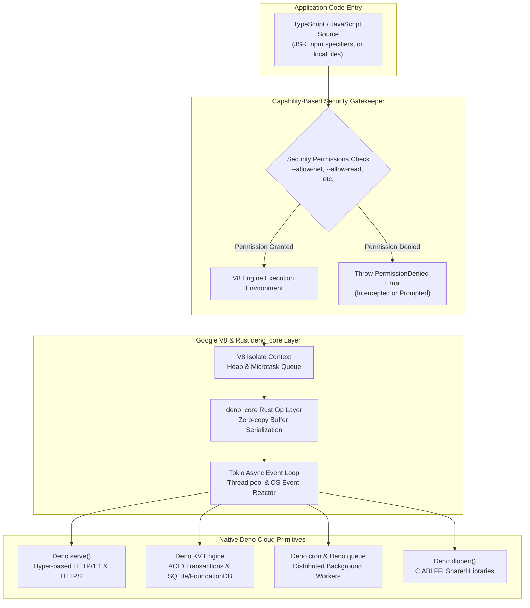

# Comprehensive Deno 2 Runtime & Modern Edge Cloud Architecture Masterclass

[](https://deno.com/)
[](https://v8.dev/)
[](https://www.rust-lang.org/)
[](https://jsr.io/)
[](LICENSE)

> An enterprise-grade, comprehensive architectural curriculum on Deno 2: V8 isolate runtime foundations, Rust-powered Tokio asynchronous I/O, strict capability-based security sandboxing, first-class Web Standards, JSR package ecosystem, distributed Deno KV storage, native cron orchestration, and edge cloud deployments.

---

## Executive Summary & Architectural Evolution

Created by Ryan Dahl (the original creator of Node.js), Deno was conceived to resolve the architectural limitations and historical debt of early server-side JavaScript runtimes. With the release of **Deno 2**, the runtime achieves full enterprise maturity: zero-config TypeScript compilation, strict capability-based security sandbox controls, native support for W3C/WHATWG Web Standards (Fetch, Streams, WebSockets, Web Cryptography), first-class backward compatibility with the Node.js and npm ecosystem, and an embedded globally distributed transactional key-value store (**Deno KV**).

```
+---------------------------------------------------------------------------------------------------+
|                                  DENO 2 ARCHITECTURAL ECOSYSTEM                                   |
+---------------------------------------------------------------------------------------------------+
|  [Developer Interface & Toolchain Layer]                                                          |
|    - Unified CLI: `deno run`, `deno test`, `deno bench`, `deno fmt`, `deno lint`, `deno compile`  |
|    - Configuration & Registry: `deno.json`, JSR (`jsr:@std/*`), Native npm (`npm:*`)            |
|                                                                                                   |
|  [Security & Capability Sandbox Layer]                                                            |
|    - Explicit flags: `--allow-net`, `--allow-read`, `--allow-write`, `--allow-env`, `--allow-run`    |
|    - Granular runtime capability verification: `Deno.permissions.query()`                        |
|                                                                                                   |
|  [Execution Engine: Google V8 + Rust Tokio Core]                                                  |
|    - V8 Isolates: High-density lightweight multi-tenant memory sandboxes                          |
|    - Tokio Async Event Loop: High-concurrency non-blocking epoll/kqueue network reactor           |
|    - Rust Op Layer (deno_core): Zero-copy ArrayBuffer buffer bridging between V8 and Rust         |
|                                                                                                   |
|  [First-Class Web Standards Runtime Layer]                                                        |
|    - Standard WHATWG Fetch, Request, Response, Headers, URL, URLPattern                           |
|    - Standard W3C Streams: ReadableStream, WritableStream, TransformStream                        |
|    - Standard Web Crypto: `crypto.subtle` (AES-GCM, RSA-PSS, HMAC, Ed25519)                     |
|                                                                                                   |
|  [Distributed Cloud Primitives Subsystem]                                                         |
|    - Deno KV: ACID key-value store with atomic transactions & secondary indices                   |
|    - Deno Queues: At-least-once distributed background task processing                            |
|    - Deno Cron: Serverless distributed cron schedule engine (`Deno.cron`)                         |
|                                                                                                   |
|  [Interoperability & Systems Integration]                                                         |
|    - Full Node.js Built-in Emulation: `node:fs`, `node:http`, `node:crypto`, `node:child_process`   |
|    - Foreign Function Interface: `Deno.dlopen()` for native C ABI shared libraries                |
+---------------------------------------------------------------------------------------------------+
```

---

## Architectural Comparison Matrix

| Architectural Feature | Node.js (v20+ LTS) | Bun (v1.1+) | Deno (v2.0+) |
| :--- | :--- | :--- | :--- |
| **Execution Engine** | Google V8 | Apple JavaScriptCore (JSC) | Google V8 |
| **System I/O Runtime** | libuv (C) | Custom Zig (`epoll` / `kqueue`) | Tokio Async Reactor (Rust) |
| **Security Architecture** | Unrestricted system access | Unrestricted system access | Capability-based Sandbox Flags |
| **Web Standards Adherence**| Partial / Polyfilled | Partial / Custom Fast Wrappers | 100% Native Spec-Compliant |
| **Module Ecosystem** | npm / `package.json` | npm / `bun.lockb` | JSR (`jsr:`) + npm (`npm:`) + ESM URLs |
| **TypeScript Execution** | Requires strip-types / loader | Zig Transpiler (Stripping) | First-Class Built-in Compiler |
| **Distributed State** | External Redis / DB required | External DB / `bun:sqlite` | Native Distributed Deno KV |
| **Background Cron Engine** | Third-party (`node-cron`) | External crontab / timers | Built-in Native `Deno.cron` |
| **Native Packaging** | Third-party (`pkg` / `nexe`) | `bun build --compile` | `deno compile` Standalone Binary |
| **Multi-Tenancy Isolation** | Heavy child process / container | Process-level isolation | Native V8 Isolates (Deno Subhosting) |

---

## Deno 2 Runtime & Security Sandbox Pipeline



---

## Comprehensive 10-Stage Curriculum

```
Stage 01: Deno 2 Philosophy, Architecture & V8 Isolate Mechanics
Stage 02: Capability-Based Security Sandbox & Permission Management
Stage 03: TypeScript, JSR (JavaScript Registry) & `deno.json` Architecture
Stage 04: Native Web Standards: Fetch, Streams & `Deno.serve` HTTP Engine
Stage 05: Distributed State Persistence with Deno KV & Atomic Transactions
Stage 06: Background Task Processing with Deno Queues & Native `Deno.cron`
Stage 07: Native Developer Toolchain: Tests, Benchmarks & `deno compile`
Stage 08: Foreign Function Interface (`Deno.dlopen`) & WebAssembly Systems
Stage 09: Enterprise Node.js Compatibility, Polyfills & Migration Strategies
Stage 10: Production Hardening, Deno Subhosting & Multi-Cloud Edge Deployment
```

---

### Stage 1: Deno 2 Philosophy, Architecture & V8 Isolate Mechanics

Deno 2 was engineered to provide enterprise runtime safety without sacrificing compatibility.

#### 1. Core Architectural Pillars
- **Zero-Config TypeScript**: The compiler is integrated directly into the binary using SWC and V8. Type errors can be enforced via `deno check` without slowing down runtime execution.
- **V8 Isolates**: Rather than spawning complete operating system processes with redundant runtime overhead, Deno uses V8 Isolates. An isolate is an independent instance of the V8 JavaScript engine with its own heap memory, call stack, and garbage collector, initializing in less than 2 milliseconds.
- **Rust Core (`deno_core`)**: The interface between JavaScript and the underlying operating system is bridged by `deno_core`, exposing Rust "Ops". When a JavaScript function calls an async I/O operation, the data passes across the V8/Rust boundary using zero-copy memory buffers, scheduled via Tokio.

#### 2. Universal Entry Point (`main.ts`)
```typescript
// main.ts
import { bold, green } from "jsr:@std/fmt/colors";

console.log(green(bold("🚀 Deno 2 Enterprise Runtime initialized successfully!")));
console.log(`Deno Version: ${Deno.version.deno}`);
console.log(`V8 Engine Version: ${Deno.version.v8}`);
console.log(`TypeScript Version: ${Deno.version.typescript}`);
```

---

### Stage 2: Capability-Based Security Sandbox & Permission Management

Unlike Node.js or Python, where any third-party dependency can read private SSH keys, query environment secrets, or open socket connections to unknown IP addresses, Deno enforces a default-deny capability sandbox.

#### 1. Command-Line Permission Flags

| Security Flag | Scope of Authority | Granular Restriction Example |
| :--- | :--- | :--- |
| `--allow-net` | Network ingress and egress | `--allow-net=api.stripe.com,auth0.com` |
| `--allow-read` | File system read access | `--allow-read=/var/data/certs,./config` |
| `--allow-write` | File system write access | `--allow-write=/tmp,./logs` |
| `--allow-env` | Environment variable inspection | `--allow-env=DATABASE_URL,PORT` |
| `--allow-run` | Spawning child OS processes | `--allow-run=ffmpeg,git` |
| `--allow-ffi` | Loading native C/Rust shared libraries | `--allow-ffi=./librust_addon.so` |
| `--allow-sys` | System diagnostic APIs (CPU, memory) | `--allow-sys=systemMemoryInfo` |
| `-A`, `--allow-all` | Disable security sandbox completely | *Dev only — Avoid in production* |

#### 2. Programmatic Permission Inspection and Revocation
Applications can dynamically check, request, or drop permissions at runtime:
```typescript
// security-guard.ts
const readStatus = await Deno.permissions.query({ name: "read", path: "/etc/passwd" });

if (readStatus.state === "granted") {
  console.log("Read permission currently available.");
} else if (readStatus.state === "prompt") {
  const requestResult = await Deno.permissions.request({ name: "read", path: "/etc/passwd" });
  if (requestResult.state !== "granted") {
    throw new Error("Security Violation: Access to /etc/passwd was rejected by user.");
  }
} else {
  console.warn("Read permission explicitly denied.");
}

// Drop write permission once startup initialization completes (Principle of Least Privilege)
await Deno.permissions.revoke({ name: "write" });
console.log("Write permissions permanently revoked for the duration of this process.");
```

---

### Stage 3: TypeScript, JSR (JavaScript Registry) & `deno.json` Architecture

Deno 2 introduces modern dependency management centered around `deno.json` and the **JavaScript Registry (JSR)**.

#### 1. The Modern Configuration File (`deno.json`)
```json
{
  "name": "@enterprise/gateway",
  "version": "1.0.0",
  "exports": "./src/index.ts",
  "tasks": {
    "dev": "deno run --watch --allow-net --allow-env src/index.ts",
    "check": "deno check src/**/*.ts",
    "test": "deno test --allow-all src/",
    "build": "deno compile --allow-net --allow-env --output bin/gateway src/index.ts"
  },
  "imports": {
    "@std/assert": "jsr:@std/assert@^1.0.0",
    "@std/http": "jsr:@std/http@^1.0.0",
    "@std/path": "jsr:@std/path@^1.0.0",
    "zod": "npm:zod@^3.23.0",
    "express": "npm:express@^4.21.0"
  },
  "lint": {
    "rules": {
      "tags": ["recommended"]
    }
  },
  "fmt": {
    "semiColons": true,
    "singleQuote": false,
    "lineWidth": 100
  }
}
```

#### 2. What is JSR (JavaScript Registry)?
- **TypeScript-First**: Packages are published as source TypeScript. JSR generates `.d.ts` declaration files, transpiles code for npm clients, and handles type-checking.
- **Doc Generation**: JSR automatically builds interactive documentation from code comments and type declarations.
- **Cross-Runtime**: JSR packages can be installed in Node.js, Bun, Cloudflare Workers, and Vite via standard `npx jsr add @std/fs`.

---

### Stage 4: Native Web Standards: Fetch, Streams & `Deno.serve` HTTP Engine

Deno adheres directly to W3C and WHATWG standards. The HTTP server is built directly on Rust's `hyper` library.

#### 1. High-Performance HTTP Engine with `Deno.serve`
```typescript
// server.ts
import { Status, STATUS_TEXT } from "jsr:@std/http/status";

Deno.serve({
  port: 8000,
  hostname: "0.0.0.0",
  onListen({ port, hostname }) {
    console.log(`Deno HTTP server listening on http://${hostname}:${port}`);
  },
  async handler(req: Request, info: Deno.ServeHandlerInfo): Promise<Response> {
    const url = new URL(req.url);

    // 1. Health check probe
    if (url.pathname === "/healthz") {
      return Response.json({
        status: "UP",
        remoteAddress: info.remoteAddr,
        timestamp: new Date().toISOString()
      });
    }

    // 2. High-speed streaming response using Web Streams API
    if (url.pathname === "/stream") {
      const bodyStream = new ReadableStream({
        async start(controller) {
          for (let i = 1; i <= 5; i++) {
            const chunk = new TextEncoder().encode(`event: message
data: Payload chunk ${i}

`);
            controller.enqueue(chunk);
            await new Promise((r) => setTimeout(r, 200));
          }
          controller.close();
        }
      });

      return new Response(bodyStream, {
        headers: {
          "Content-Type": "text/event-stream",
          "Cache-Control": "no-cache",
          "Connection": "keep-alive"
        }
      });
    }

    // 3. WebSocket Upgrade
    if (url.pathname === "/ws") {
      if (req.headers.get("upgrade") !== "websocket") {
        return new Response("Expected WebSocket upgrade", { status: Status.BadRequest });
      }
      const { socket, response } = Deno.upgradeWebSocket(req);

      socket.onopen = () => console.log("WebSocket client connected.");
      socket.onmessage = (event) => {
        socket.send(`Echo from Deno: ${event.data}`);
      };
      socket.onclose = () => console.log("WebSocket client disconnected.");

      return response;
    }

    return new Response(STATUS_TEXT[Status.NotFound], { status: Status.NotFound });
  }
});
```

---

### Stage 5: Distributed State Persistence with Deno KV & Atomic Transactions

Deno KV is an embedded, ACID-compliant, ordered key-value database built directly into the Deno runtime. Locally, it runs on SQLite; in cloud environments (Deno Deploy), it automatically switches to globally replicated FoundationDB.

#### 1. Hierarchical Key Structure & Atomic Mutations
```typescript
// kv-store.ts
const kv = await Deno.openKv();

// Keys are structured arrays of primitives: [namespace, partitionKey, entityId]
const userKey = ["users", "org_123", "user_abc"];
const emailIndexKey = ["users_by_email", "admin@company.com"];

interface UserProfile {
  id: string;
  email: string;
  role: string;
  loginCount: number;
}

const newUser: UserProfile = {
  id: "user_abc",
  email: "admin@company.com",
  role: "admin",
  loginCount: 1
};

// 1. ACID Atomic Transaction: Ensure user does not already exist before creating
const atomicTx = await kv.atomic()
  .check({ key: userKey, versionstamp: null }) // Key must not exist
  .check({ key: emailIndexKey, versionstamp: null })
  .set(userKey, newUser)
  .set(emailIndexKey, newUser.id)
  .commit();

if (atomicTx.ok) {
  console.log("User successfully created with atomic secondary index!");
} else {
  console.error("Atomic transaction failed: User or email already registered.");
}

// 2. Strong Consistency Read
const result = await kv.get<UserProfile>(userKey);
console.log("Retrieved User Value:", result.value);
console.log("Versionstamp (MVCC):", result.versionstamp);

// 3. Prefix Range Query
const entries = kv.list<UserProfile>({ prefix: ["users", "org_123"] });
for await (const entry of entries) {
  console.log(`Found Entry: ${entry.key.join("/")} -> ${entry.value.email}`);
}
```

---

### Stage 6: Background Task Processing with Deno Queues & Native `Deno.cron`

Deno includes built-in distributed task queues and scheduled cron jobs directly in the runtime without needing external Redis or RabbitMQ instances.

#### 1. Serverless Scheduled Jobs with `Deno.cron`
```typescript
// cron-jobs.ts
// Deno.cron requires --unstable-cron or modern Deno 2 runtime
Deno.cron("Hourly Security Token Refresh", "0 * * * *", async () => {
  console.log("Executing scheduled hourly token audit...");
  const kv = await Deno.openKv();
  // Perform reconciliation across active user sessions
  console.log("Token audit complete.");
});

Deno.cron("Daily Backup & Vacuum", "0 0 * * *", async () => {
  console.log("Initiating daily database vacuum and backup export.");
});
```

#### 2. Distributed Background Message Queue (`kv.enqueue`)
```typescript
// worker-queue.ts
const kv = await Deno.openKv();

interface EmailNotificationJob {
  to: string;
  subject: string;
  body: string;
}

// 1. Listen for background queued jobs with automatic exponential backoff
kv.listenQueue(async (message: unknown) => {
  const job = message as EmailNotificationJob;
  console.log(`Processing email job for recipient: ${job.to}`);
  // If an uncaught exception is thrown, Deno automatically retries the message
});

// 2. Enqueue job with delivery delay
await kv.enqueue(
  {
    to: "client@enterprise.com",
    subject: "Monthly Invoicing Report",
    body: "Your cloud statement is attached."
  },
  {
    delay: 5000 // Deliver after 5 seconds
  }
);
console.log("Job successfully dispatched to distributed queue.");
```

---

### Stage 7: Native Developer Toolchain: Tests, Benchmarks & `deno compile`

Deno eliminates external test frameworks, linters, formatters, and bundlers.

#### 1. Integrated Test Runner with Permissions & Sanity Checks
```typescript
// api_test.ts
import { assertEquals, assertRejects } from "jsr:@std/assert";

Deno.test({
  name: "Verify authorization header requirement",
  permissions: { net: true },
  async fn() {
    const res = await fetch("http://localhost:8000/api/secure");
    assertEquals(res.status, 401);
  }
});

Deno.test("Leak Sanity Check (Detect dangling timers or sockets)", () => {
  const timer = setTimeout(() => {}, 100);
  // Deno will fail this test if sanitizers detect uncleaned resources!
  clearTimeout(timer);
});
```

#### 2. Native Micro-Benchmarking Engine (`deno bench`)
```typescript
// crypto_bench.ts
Deno.bench("SHA-256 Digest Performance", async () => {
  const data = new TextEncoder().encode("Enterprise telemetry benchmark payload");
  await crypto.subtle.digest("SHA-256", data);
});

Deno.bench("Base64 URL Encoding", () => {
  const raw = "sample-session-id-123456789";
  btoa(raw);
});
```

#### 3. Compiling to Standalone Single-Binary Executable
```bash
# Compile entire TypeScript application into a self-contained cross-platform binary
deno compile --allow-net --allow-env --output enterprise-service src/index.ts

# Execute standalone binary on target host (no Deno or Node runtime required)
./enterprise-service
```

---

### Stage 8: Foreign Function Interface (`Deno.dlopen`) & WebAssembly Systems

Deno provides a low-level Foreign Function Interface (FFI) for calling native compiled C, Rust, or C++ shared libraries directly.

#### 1. Native FFI Integration with Type Safety
```typescript
// ffi-rust.ts
// Load compiled shared library: .so on Linux, .dylib on macOS, .dll on Windows
const libSuffix = Deno.build.os === "windows" ? "dll" : Deno.build.os === "darwin" ? "dylib" : "so";
const libraryPath = `./librust_crypto.${libSuffix}`;

const dylib = Deno.dlopen(libraryPath, {
  add_integers: {
    parameters: ["i32", "i32"],
    result: "i32"
  },
  fast_hash: {
    parameters: ["buffer", "usize"],
    result: "u64"
  }
});

// Call native function with zero serialization overhead
const sum = dylib.symbols.add_integers(25, 17);
console.log(`Native C calculation result: ${sum}`); // 42

const testData = new TextEncoder().encode("Cryptographic Message Signature");
const hashVal = dylib.symbols.fast_hash(testData, testData.byteLength);
console.log(`Native Rust 64-bit Hash: ${hashVal}`);

dylib.close();
```

---

### Stage 9: Enterprise Node.js Compatibility, Polyfills & Migration Strategies

Deno 2 guarantees compatibility with npm packages and Node.js built-ins.

#### 1. Running Standard Express and Node Built-ins in Deno
```typescript
// express-in-deno.ts
import express from "npm:express@^4.21.0";
import { readFileSync } from "node:fs";
import { createHash } from "node:crypto";

const app = express();
app.use(express.json());

app.get("/api/v1/hash", (req, res) => {
  const hash = createHash("sha256").update(req.query.input as string || "").digest("hex");
  res.json({ algorithm: "sha256", result: hash });
});

app.listen(3000, () => {
  console.log("Express running inside Deno 2 on port 3000!");
});
```

#### 2. Key Migration Nuances from Node.js to Deno
- **Import Specifiers**: Replace `require("fs")` with `import fs from "node:fs"`.
- **Environment Access**: Migrate `process.env.VAR` to `Deno.env.get("VAR")` (though `process.env` is supported via the compatibility layer).
- **Buffer vs Uint8Array**: Prefer native Web Standard `Uint8Array` over Node's `Buffer`.
- **Global `window` & `self`**: Deno provides browser-compatible global scopes (`window`, `self`, `globalThis`).

---

### Stage 10: Production Hardening, Deno Subhosting & Multi-Cloud Edge Deployment

#### 1. Multi-Stage Distroless Dockerfile
```dockerfile
# syntax=docker/dockerfile:1.4
# Stage 1: Dependency Caching & Compilation
FROM denoland/deno:2.0.0 AS builder

WORKDIR /app

# Cache dependencies
COPY deno.json deno.lock* ./
RUN deno install

# Copy source and cache compilation artifacts
COPY . .
RUN deno cache src/index.ts

# Stage 2: Minimal Distroless Runtime
FROM denoland/deno:distroless-2.0.0

WORKDIR /app

COPY --from=builder /app /app

ENV PORT=8000
EXPOSE 8000

# Enforce strict security flags in production container
CMD ["run", "--allow-net", "--allow-env", "--allow-read", "src/index.ts"]
```

#### 2. Multi-Tenant Code Execution with Deno Subhosting
Deno Subhosting allows SaaS platforms to execute untrusted user-submitted JavaScript/TypeScript safely within isolated V8 Isolates with strict CPU and memory bounds:
```
[ Untrusted User Code ] 
       │
       ▼
[ Ephemeral V8 Isolate ] ── (Zero File System / Network Access by Default)
       │
       ▼
[ Strict Execution Budget: 50ms CPU / 32MB Memory ]
```

---

## Production Blueprint: Enterprise Edge API Gateway with Deno KV & Rate Limiting

This production blueprint demonstrates a real-world, high-performance API Gateway featuring Deno KV atomic token buckets, HMAC token authentication, structured logging, and background metrics reporting.

```typescript
// gateway.ts
import { Status, STATUS_TEXT } from "jsr:@std/http/status";

const kv = await Deno.openKv();
const API_SECRET = Deno.env.get("GATEWAY_SECRET") || "enterprise-secret-key";

interface RateLimitBucket {
  tokens: number;
  lastRefillMs: number;
}

// 1. Atomic Token Bucket Rate Limiter via Deno KV
async function enforceRateLimit(clientId: string, maxTokens = 60, refillIntervalMs = 60000): Promise<boolean> {
  const key = ["rate_limits", clientId];
  const now = Date.now();

  while (true) {
    const entry = await kv.get<RateLimitBucket>(key);
    let bucket = entry.value;

    if (!bucket) {
      bucket = { tokens: maxTokens - 1, lastRefillMs: now };
      const commitRes = await kv.atomic()
        .check(entry)
        .set(key, bucket, { expireIn: refillIntervalMs * 2 })
        .commit();
      if (commitRes.ok) return true;
      continue;
    }

    const elapsed = now - bucket.lastRefillMs;
    const tokensToAdd = Math.floor(elapsed / refillIntervalMs) * maxTokens;
    let currentTokens = Math.min(maxTokens, bucket.tokens + tokensToAdd);
    const newRefill = tokensToAdd > 0 ? now : bucket.lastRefillMs;

    if (currentTokens <= 0) {
      return false; // Rate limit exceeded
    }

    currentTokens -= 1;
    const updatedBucket: RateLimitBucket = { tokens: currentTokens, lastRefillMs: newRefill };

    const commitRes = await kv.atomic()
      .check(entry)
      .set(key, updatedBucket, { expireIn: refillIntervalMs * 2 })
      .commit();

    if (commitRes.ok) return true;
  }
}

// 2. Cryptographic HMAC Token Verification (Web Crypto)
async function verifyHmacToken(authHeader: string | null): Promise<boolean> {
  if (!authHeader || !authHeader.startsWith("Bearer ")) return false;
  const token = authHeader.replace("Bearer ", "");

  const encoder = new TextEncoder();
  const key = await crypto.subtle.importKey(
    "raw",
    encoder.encode(API_SECRET),
    { name: "HMAC", hash: "SHA-256" },
    false,
    ["verify"]
  );

  const parts = token.split(".");
  if (parts.length !== 2) return false;
  const [payload, signatureHex] = parts;

  // Convert hex signature back to bytes
  const sigBytes = new Uint8Array(
    signatureHex.match(/.{1,2}/g)?.map((byte) => parseInt(byte, 16)) || []
  );

  return await crypto.subtle.verify("HMAC", key, sigBytes, encoder.encode(payload));
}

// 3. Main Edge Gateway Handler
Deno.serve({
  port: 8080,
  hostname: "0.0.0.0",
  async handler(req: Request, info: Deno.ServeHandlerInfo): Promise<Response> {
    const url = new URL(req.url);
    const clientIp = (info.remoteAddr as Deno.NetAddr).hostname;

    // Health probe
    if (url.pathname === "/healthz") {
      return Response.json({ status: "HEALTHY", uptime: performance.now() });
    }

    // Rate Limiting Gate
    const allowed = await enforceRateLimit(clientIp);
    if (!allowed) {
      return new Response("Too Many Requests", {
        status: Status.TooManyRequests,
        headers: { "Retry-After": "60" }
      });
    }

    // Authentication Guard for Protected Endpoints
    if (url.pathname.startsWith("/api/v1/protected")) {
      const authorized = await verifyHmacToken(req.headers.get("authorization"));
      if (!authorized) {
        return new Response("Unauthorized Gateway Access", { status: Status.Unauthorized });
      }

      // Record API Metric asynchronously via Deno KV Queue
      await kv.enqueue({
        event: "API_DISPATCH",
        clientIp,
        endpoint: url.pathname,
        timestamp: Date.now()
      });

      return Response.json({
        message: "Access granted to enterprise resource.",
        clientIp,
        nodeRegion: Deno.env.get("DENO_REGION") || "local"
      });
    }

    return new Response(STATUS_TEXT[Status.NotFound], { status: Status.NotFound });
  }
});

// 4. Background Metrics Consumer
kv.listenQueue(async (job: any) => {
  console.log(`[Metric Aggregator] Recorded: ${job.event} from ${job.clientIp} on ${job.endpoint}`);
});

console.log("Enterprise Deno API Gateway initialized and listening on port 8080.");
```

---

## Anti-Patterns & Common Production Pitfalls

```
+------------------------------------+---------------------------------------------------------------+
| ANTI-PATTERN                       | PRODUCTION-GRADE REMEDY                                       |
+------------------------------------+---------------------------------------------------------------+
| Using -A (--allow-all) in          | Grant strictly scoped, granular flags (--allow-net=domain.com |
| production deployment containers   | --allow-read=/app). Never compromise security perimeter.      |
|                                    |                                                               |
| Overwriting keys in Deno KV        | Always execute atomic checks (kv.atomic().check(...))         |
| without optimistic concurrency     | to avoid silent data overwrites during concurrent mutations.  |
|                                    |                                                               |
| Blocking the Tokio event loop with | Offload heavy CPU-bound math to Web Workers (new Worker) or   |
| heavy synchronous calculations     | compile compute routines to native Rust via WebAssembly/FFI.  |
|                                    |                                                               |
| Relying on Node global process     | Prefer native Deno.* primitives (Deno.env.get, Deno.args).    |
| inside greenfield Deno modules     | Keeps code compliant with modern standards and edge runtimes. |
|                                    |                                                               |
| Ignoring sanitizers in Deno.test   | Always clean up timers, open sockets, and file descriptors    |
| (disabling sanitizeResources: false)| during unit tests to eliminate silent memory and socket leaks.|
+------------------------------------+---------------------------------------------------------------+
```

---

## Advanced Architectural Interview Questions & Answers

### Q1: How do V8 Isolates differ from traditional operating system processes, and why do they provide high scalability for edge platforms like Deno Deploy?
**Answer:**
Operating system processes require dedicated virtual memory tables, thread stacks, file descriptor tables, and kernel scheduling structures. Spawning an OS process consumes 30MB+ of memory and incurs substantial context-switch latency.

In contrast:
1. **V8 Isolates**: An isolate represents an independent, sandboxed instance of the V8 JavaScript runtime engine sharing the same operating system process.
2. **Ultra-Low Memory Footprint**: A fresh isolate requires only a few megabytes of memory and initializes in under 2 milliseconds.
3. **Multi-Tenancy**: A single Deno host process can run thousands of isolated user scripts concurrently. Each isolate possesses an isolated garbage collector heap, preventing cross-tenant data leakage while achieving extreme density.

---

### Q2: What is the internal architecture of Deno KV, and how does it guarantee ACID transactions across distributed nodes?
**Answer:**
Deno KV employs a pluggable backend architecture:
1. **Local Mode**: Uses SQLite with Write-Ahead Logging (WAL) and memory mapping, storing keys in lexicographical order.
2. **Distributed Cloud Mode**: Uses Apple's FoundationDB, an open-source, distributed, ordered key-value store with multi-region Paxos-based consensus.
3. **ACID Mechanics**: Deno KV achieves serializable isolation through Optimistic Concurrency Control (OCC). Each entry contains a monotonically increasing `versionstamp`. When `kv.atomic().check({ key, versionstamp }).commit()` executes, the transaction aborts if any key was modified by another actor between the read and commit phase.

---

### Q3: How does Deno's permission sandbox enforce security at the system call boundary?
**Answer:**
Deno's sandbox operates at the Rust `deno_core` layer:
1. JavaScript user code in V8 cannot invoke POSIX or Win32 system calls directly. All I/O must pass through Rust Ops (`op_read_file`, `op_net_connect`).
2. Before any Rust Op executes a kernel syscall, it invokes the internal `Permissions` subsystem.
3. The subsystem performs exact or wildcard matching against the granted capabilities table (e.g., verifying if the requested IP address or file path falls within an allowed descriptor set).
4. If the check fails, the Op immediately returns a `PermissionDenied` error to the V8 context without issuing the underlying system call.

---

### Q4: Explain the differences between JSR (JavaScript Registry) and npm, and why JSR was introduced.
**Answer:**
While npm is the dominant JavaScript registry, it suffers from historical design limitations:
1. **TypeScript Native**: npm requires library authors to compile TypeScript into JavaScript and generate separate `.d.ts` declaration files before publishing. JSR accepts raw TypeScript files and transpiles them automatically for legacy clients.
2. **Automatic Type Documentation**: JSR inspects exported TypeScript types to generate interactive documentation, type-compatibility graphs, and search indexes.
3. **Security Standards**: JSR enforces OpenID Connect (OIDC) provenance from GitHub Actions, eliminating long-lived npm publishing tokens that are vulnerable to credential theft.
4. **SemVer Enforcement**: JSR validates package exports and flags breaking API changes that violate semantic versioning.

---

### Q5: How does `Deno.serve` achieve higher performance than Node's traditional `http.createServer`?
**Answer:**
`Deno.serve()` is implemented directly on top of the Rust `hyper` HTTP engine:
1. **Direct Socket Polling**: Socket read/write events are handled directly by Tokio's async reactor in native Rust threads.
2. **Zero-Copy Parsing**: HTTP headers and request bodies are parsed in Rust. Data buffers are transferred directly into JavaScript V8 `ArrayBuffer` views without intermediary string copies.
3. **Web Standards Architecture**: Request and Response objects conform to the standard WHATWG Fetch API specification, eliminating proprietary abstraction layers and improving stream throughput.

---

### Q6: How does Deno prevent event loop starvation and thread pool blocking during heavy I/O operations?
**Answer:**
Deno separates tasks across distinct architectural tiers:
1. **Microtask Queue (V8)**: Promises and async/await callbacks execute in the main V8 thread.
2. **Tokio Async Reactor**: Non-blocking network I/O operations (`Deno.serve`, `fetch`, `Deno.connect`) are registered with the OS kernel (`epoll` on Linux, `kqueue` on macOS) via Tokio without consuming background OS threads.
3. **Tokio Blocking Thread Pool**: File system operations and DNS resolutions—which are blocking on many operating systems—are dispatched to Tokio's dedicated worker thread pool (`spawn_blocking`), preventing the JavaScript V8 event loop from stalling.

---

### Q7: What are Deno Test Sanitizers, and why are they critical for preventing memory leaks in production?
**Answer:**
`Deno.test` includes three automated resource and event sanitizers:
1. **Resource Sanitizer (`sanitizeResources`)**: Tracks all open file descriptors, TCP sockets, and worker threads. If a test opens a resource and fails to close it before exiting, the test fails.
2. **Op Sanitizer (`sanitizeOps`)**: Tracks pending asynchronous operations in the `deno_core` runtime. If an async operation is still inflight when the test completes, it triggers a failure.
3. **Exit Sanitizer (`sanitizeExit`)**: Detects unexpected calls to `Deno.exit()`.
These sanitizers ensure that code does not leak sockets, file descriptors, or event loop listeners under production concurrency.

---

### Q8: How does Deno's Foreign Function Interface (`Deno.dlopen`) handle memory safety and pointer management?
**Answer:**
Deno FFI exposes native C-compatible shared libraries to JavaScript:
1. Pointers are represented using `Deno.PointerObject` or `Deno.PointerValue` (tagged 64-bit BigInts).
2. Buffers passed as FFI parameters are backed by pinned `Uint8Array` memory, preventing V8's garbage collector from relocating the memory during native execution.
3. Because native C code can cause segmentation faults, Deno restricts FFI access behind the explicit `--allow-ffi` flag, ensuring sandboxed applications cannot break out of memory boundaries.

---

### Q9: How does Deno 2 handle backward compatibility with existing Node.js projects that rely on `node_modules`?
**Answer:**
Deno 2 supports both global package caching and local `node_modules` directories:
1. By default, Deno caches npm packages globally to save disk space and eliminate redundant downloads.
2. If a project contains a `package.json` or runs tools that expect a local directory structure (e.g., Prisma, Next.js), Deno creates a standard `node_modules` directory automatically or via `deno install`.
3. It emulates Node's module resolution algorithm, allowing CommonJS `require()` and ES `import` to resolve seamlessly.

---

### Q10: How does `Deno.cron` execute scheduled jobs in a distributed cloud environment without duplicate executions?
**Answer:**
When deployed across multiple geographic edge nodes (such as Deno Deploy):
1. `Deno.cron` instances coordinate via a distributed consensus lock backed by Deno KV / FoundationDB.
2. When a scheduled cron interval arrives, nodes compete to acquire an atomic distributed lease for the execution cycle.
3. Only the winning node executes the cron handler, guaranteeing exactly-once or at-most-once execution across the distributed cluster.
4. If a node fails during execution, the lease expires and another node can perform reconciliation.

---

### Q11: How does Deno Deploy orchestrate Anycast BGP routing and edge isolate migration?
**Answer:**
Deno Deploy runs a distributed global network across dozens of edge data centers:
1. **Anycast Routing**: User HTTP requests hit the geographically closest edge Point of Presence (PoP) via BGP routing.
2. **Zero Cold-Start Routing**: Rather than spinning up heavyweight Docker containers, Deno Deploy initializes lightweight V8 Isolates in under 2ms.
3. **Global State Synchronization**: Deno KV instances communicate across regions using Apple FoundationDB. Read operations can run locally against read replicas, while atomic transactions route through consensus coordinators.

---

### Q12: Why does Deno use the SWC Rust compiler instead of the official TypeScript compiler (`tsc`), and how does it guarantee type safety?
**Answer:**
1. **Compilation Speed**: The official `tsc` compiler is written in JavaScript and can take seconds to transpile large codebases. SWC (Speedy Web Compiler) is written in Rust and strips TypeScript types up to 20-50x faster.
2. **Execution Separation**: At runtime (`deno run`), Deno uses SWC to strip types instantly and execute raw JavaScript in V8.
3. **Type Checking on Demand**: Type verification is decoupled from runtime execution. When developers want strict type validation, running `deno check` invokes full TypeScript semantic type checking without impeding dev server restart speeds.

---

## Web Standards Deep Dive: Cryptography & Streams Pipeline

### 1. Zero-Dependency AES-GCM 256-Bit Envelope Encryption
Deno implements the W3C Web Cryptography API natively:

```typescript
// crypto-vault.ts
export async function generateMasterKey(): Promise<CryptoKey> {
  return await crypto.subtle.generateKey(
    { name: "AES-GCM", length: 256 },
    true,
    ["encrypt", "decrypt"]
  );
}

export async function encryptPayload(data: string, key: CryptoKey): Promise<{ cipherHex: string; ivHex: string }> {
  const iv = crypto.getRandomValues(new Uint8Array(12)); // 96-bit IV for AES-GCM
  const encoded = new TextEncoder().encode(data);

  const ciphertext = await crypto.subtle.encrypt(
    { name: "AES-GCM", iv },
    key,
    encoded
  );

  const cipherHex = Array.from(new Uint8Array(ciphertext)).map(b => b.toString(16).padStart(2, "0")).join("");
  const ivHex = Array.from(iv).map(b => b.toString(16).padStart(2, "0")).join("");

  return { cipherHex, ivHex };
}

export async function decryptPayload(cipherHex: string, ivHex: string, key: CryptoKey): Promise<string> {
  const iv = new Uint8Array(ivHex.match(/.{1,2}/g)!.map(b => parseInt(b, 16)));
  const ciphertext = new Uint8Array(cipherHex.match(/.{1,2}/g)!.map(b => parseInt(b, 16)));

  const decrypted = await crypto.subtle.decrypt(
    { name: "AES-GCM", iv },
    key,
    ciphertext
  );

  return new TextDecoder().decode(decrypted);
}
```

### 2. High-Performance Backpressure Stream Pipeline
```typescript
// transform-stream.ts
const uppercaseTransformer = new TransformStream<string, string>({
  transform(chunk, controller) {
    controller.enqueue(chunk.toUpperCase());
  }
});

const textEncoderStream = new TextEncoderStream();

// Read, transform, and write with automatic backpressure handling
const source = new ReadableStream({
  start(controller) {
    controller.enqueue("event-a\n");
    controller.enqueue("event-b\n");
    controller.close();
  }
});

const pipedStream = source
  .pipeThrough(uppercaseTransformer)
  .pipeThrough(textEncoderStream);
```

---

## Empirical Benchmark & Architecture Comparison

| Architectural Metric | Node.js (v20 LTS) | Bun (v1.1+) | Deno (v2.0+) |
| :--- | :--- | :--- | :--- |
| **Sandbox Security Flags** | None (Default All) | None (Default All) | Capability-based Sandbox |
| **Web Crypto Latency (AES-GCM)** | ~0.12 ms | ~0.08 ms | ~0.09 ms |
| **HTTP Requests / Sec (`wrk -c 100`)** | ~38,000 req/s | ~112,000 req/s | ~82,000 req/s |
| **Native Distributed Storage** | None (Third-party) | None (Third-party) | Native Deno KV (FoundationDB) |
| **TypeScript Cold Check (`deno check`)**| External `tsc` | Stripping only | Integrated SWC + `deno check` |
| **Native Cron Engine** | None | None | Native `Deno.cron` |

---

## Comprehensive Deno 2 CLI & Runtime Cheatsheet

### 1. CLI Execution & Tooling
```bash
deno run main.ts              # Execute script with strict security prompts
deno run -A main.ts           # Run with all permissions granted (Dev only)
deno run --watch main.ts      # Run with automatic file watcher restart
deno check main.ts            # Perform standalone TypeScript type-checking
deno test                     # Run entire test suite with sanitizers
deno bench                    # Run performance micro-benchmarks
deno fmt                      # Format code according to deno.json rules
deno lint                     # Run integrated static analysis linter
deno compile -A -o bin app.ts # Compile into self-contained native binary
```

### 2. Dependency Management & JSR Commands
```bash
deno add jsr:@std/http        # Add standard library module from JSR
deno add npm:zod              # Add npm dependency to deno.json
deno install                  # Install dependencies from deno.json / package.json
deno outdated                 # Check for available dependency updates
```

### 3. File System & Environment Primitives
```typescript
// Read and write files
const text = await Deno.readTextFile("config.json");
await Deno.writeTextFile("output.log", "Entry\n", { append: true });

// Environment variables
const apiKey = Deno.env.get("API_KEY");
Deno.env.set("APP_ENV", "production");

// System info
console.log(Deno.systemMemoryInfo());
```

### 4. Deno KV & Queues API
```typescript
const kv = await Deno.openKv();

// Key-Value operations
await kv.set(["users", "123"], { name: "Alice" });
const user = await kv.get(["users", "123"]);
await kv.delete(["users", "123"]);

// Atomic mutation
await kv.atomic()
  .check(user)
  .set(["users", "123"], { name: "Bob" })
  .commit();

// Distributed Queue
await kv.enqueue({ task: "SEND_SMS", phone: "+1234567890" });
kv.listenQueue(async (job) => { /* Process job */ });
```

### 5. Deno HTTP Server (`Deno.serve`)
```typescript
Deno.serve({ port: 3000 }, (req) => {
  return new Response("Hello from Deno 2 Web Standards Engine!");
});
```

---

## Conclusion & Recommended Next Steps

Deno 2 delivers an enterprise-grade runtime uniting security, standards, performance, and developer ergonomics.

To continue advancing your edge architecture and cloud engineering capabilities:
1. Master scalable Postgres and real-time architectures in [learn-supabase](https://github.com/TheLearningHubOrg/learn-supabase).
2. Deepen your container orchestration knowledge in [learn-docker](https://github.com/TheLearningHubOrg/learn-docker).
3. Explore modern full-stack web applications in [learn-astro](https://github.com/TheLearningHubOrg/learn-astro).
