# Learn Deno 🦕

<div align="center">

[](https://opensource.org/licenses/MIT)
[](https://deno.com/)
[](https://github.com/TheLearningHubOrg/learn-deno/actions/workflows/ci.yml)
[](https://github.com/TheLearningHubOrg/learn-deno/releases)
[](https://docs.deno.com/runtime/fundamentals/typescript/)
[](https://jsr.io/)

**From your first `deno run` to staff-level Deno: the runtime, its permission sandbox, JSR and npm, web-standard servers, Deno KV and production deployment.**  
Covers the V8 and Tokio architecture, permission sets, `deno.json`, lockfiles, `Deno.serve`, Deno KV, queues and cron, testing, `deno compile`, Docker, Node.js migration, FFI and WebAssembly.

[Getting Started](#1-stage-1-runtime-foundations--the-built-in-toolchain) • [Security](#2-stage-2-the-security-model--permissions) • [Modules](#3-stage-3-modules-dependencies--configuration) • [HTTP](#4-stage-4-web-standards--http-servers) • [Persistence](#5-stage-5-persistence--background-work-deno-kv-queues--cron) • [Production](#6-stage-6-testing-tooling--production-deployment) • [Interview Prep](#7-stage-7-staff-deno-engineer-interview-handbook--cheatsheet)

<br/>

<a href="https://www.buymeacoffee.com/manthanank">
  
</a>

</div>

---

## 🗺️ 7-Stage Pedagogical Roadmap


| Stage | Focus Domain | Core Concepts & Engineering Outcomes |
| :--- | :--- | :--- |
| **Stage 1** | **Runtime Foundations & the Built-in Toolchain** | V8 isolates, Rust ops and the Tokio event loop; `deno run`, `deno serve`, `deno watch`, `deno eval`; type stripping versus `deno check`; `deno fmt`, `deno lint`, `deno test`, `deno info`. You can run, check and test the starter API. |
| **Stage 2** | **The Security Model & Permissions** | Default-deny sandbox, `--allow-*` / `--deny-*` / `--ignore-*` flags, `-P` permission sets in `deno.json`, `Deno.permissions.query/request/revoke`, `Deno.errors.NotCapable`, permissions in tests and compiled binaries, the sandbox threat model. You can ship a process with only the access it needs. |
| **Stage 3** | **Modules, Dependencies & Configuration** | `jsr:`, `npm:`, `node:` and URL specifiers, the `imports` map, `deno add/remove/outdated/update/why`, `deno.lock` with `--frozen`, `deno ci`, `nodeModulesDir`, workspaces, tasks with dependencies, `deno publish`. You can manage a reproducible multi-package project. |
| **Stage 4** | **Web Standards & HTTP Servers** | `Deno.serve`, `Request`/`Response`, `URLPattern`, streams and backpressure, Server-Sent Events, WebSockets, Web Crypto. |
| **Stage 5** | **Persistence & Background Work** | `Deno.openKv`, keys and versionstamps, `kv.atomic()` with checks, secondary indexes, `kv.enqueue`/`listenQueue`, `Deno.cron`. |
| **Stage 6** | **Testing, Tooling & Production Deployment** | `Deno.test` steps and hooks, sanitizers, `deno bench`, coverage, `deno compile`, multi-stage Docker images, Deno Deploy. |
| **Masterclasses** | **Node.js migration, FFI & Wasm, multi-tenant isolates, flagship gateway** | Running npm and Node built-ins, `Deno.dlopen`, isolate-based multi-tenancy, an end-to-end API gateway with KV rate limiting and HMAC auth. |
| **Stage 7** | **Staff Interview Handbook** | Interview Q&As on internals, security, KV consistency and production scenarios, plus a one-page cheatsheet. |

The examples in this guide and the starter project are written in **TypeScript**, because it is Deno's native language: the runtime executes `.ts` files directly, ships the TypeScript compiler for `deno check`, and its own APIs (`Deno.*`, the `@std` library on JSR) are authored and typed in TypeScript.

---

## 🆕 Deno Versions, What's New & Migration

### V.1 Release Timeline

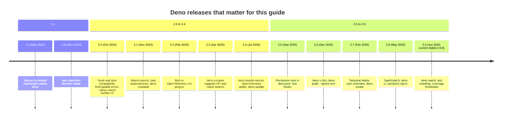

### V.2 Compatibility Matrix

| Deno | Released | Bundled TypeScript | V8 | Lockfile | Notes |
| --- | --- | --- | --- | --- | --- |
| 2.9.x | Jun 2026 | 6.0 | 15.0 | v5 | Current stable. `Deno.serve` no longer compresses responses unless you opt in. |
| 2.8 | May 2026 | 6.0 | 14.9 | v5 | Ops and resources sanitizers off by default in `deno test`. |
| 2.5 | Sep 2025 | 5.9 | 14.0 | v5 | First release with `"permissions"` in `deno.json`. |
| 2.3 | Apr 2025 | 5.8 | 13.x | v5 | Lockfile v5 becomes the default. |
| 2.2 | Feb 2025 | 5.7 | 13.4 | v4 | `Deno.cwd()` no longer needs `--allow-read`. |
| 2.0 | Oct 2024 | 5.6 | 12.x | v4 | The Deno 2 baseline this guide assumes. |
| 1.x | 2020-2024 | 4.x-5.5 | - | v2/v3 | End of life. Migrate with V.4. |

Patch releases go to the latest minor. An LTS channel receives backports for longer; `denoland/setup-deno` accepts `deno-version: lts`. Check the exact versions on your machine with `deno --version`, or at runtime with `Deno.version`.

### V.3 What's New in 2.9 (and the 2.5-2.8 features you will use daily)

#### Permission sets in `deno.json` (2.5)

Before, every command repeated its flags, and they drifted apart between the README, the Dockerfile and CI:

```bash
deno run --allow-net=0.0.0.0,127.0.0.1 --allow-env=PORT src/main.ts
```

After, the permissions live next to the code and `-P` loads the `default` set (this is what the starter's `deno task start` runs):

```json
{
  "permissions": {
    "default": { "net": ["0.0.0.0", "127.0.0.1"], "env": ["PORT"] }
  },
  "compile": { "permissions": "default" }
}
```

```bash
deno run -P src/main.ts
```

Deno prints a warning that config-file permissions are experimental. The feature is covered in [2.4](#24-permission-sets-in-denojson).

#### Test hooks (2.5)

Before, shared setup was a helper called at the top of every test. Now `Deno.test` has lifecycle hooks:

```typescript
import { assertEquals } from "@std/assert";

let calls = 0;
Deno.test.beforeEach(() => {
  calls = 0;
});

Deno.test("each test starts from zero", () => {
  calls++;
  assertEquals(calls, 1);
});
```

`beforeAll`, `afterEach` and `afterAll` work the same way.

#### Text and bytes imports (stable in 2.8)

Before, reading a template needed `--allow-read` and an `await`:

```typescript
const template = await Deno.readTextFile(new URL("./email.txt", import.meta.url));
```

After, the file becomes part of the module graph, needs no read permission, and is embedded by `deno compile`:

```typescript
import template from "./email.txt" with { type: "text" };
```

Use `with { type: "bytes" }` to get a `Uint8Array` instead.

#### TypeScript 6 and Temporal (2.7-2.8)

`deno check` now uses TypeScript 6.0, and the `Temporal` API is a stable global, so date arithmetic no longer needs a library:

```typescript
const due = Temporal.Now.plainDateISO().add({ days: 14 });
console.log(due.toString()); // e.g. "2026-11-17"
```

#### `deno ci` and test sharding (2.8-2.9)

`deno ci` installs strictly from the lockfile and fails if it is out of date, which is what a CI job wants. Large suites can be split across runners:

```bash
deno ci
deno test --shard=1/3   # run on runner 1 of 3
deno test --changed     # only tests affected by files changed in git
deno test --coverage --coverage-threshold=80
```

#### `deno watch` and opt-in compression (2.9)

`deno watch main.ts` is the dedicated subcommand for `deno run --watch` with hot module replacement. `Deno.serve` stopped compressing responses by default in 2.9; turn it back on where you want it:

```typescript
Deno.serve({ port: 8000, automaticCompression: true }, () => new Response("hi"));
```

### V.4 Migration Guide (1.x → 2.x, and between 2.x minors)

```bash
# 1. Upgrade the binary (or pin a version)
deno upgrade
deno upgrade --version 2.9.8

# 2. Replace removed flags and commands
#    --lock-write        -> deno install --frozen=false (then commit deno.lock)
#    deno cache main.ts  -> deno install --entrypoint main.ts
#    deno vendor         -> "vendor": true in deno.json
#    --unstable          -> the specific --unstable-kv, --unstable-cron, ... flags

# 3. Move std imports from deno.land/std URLs to JSR
deno add jsr:@std/assert jsr:@std/path

# 4. Let the linter find removed APIs, then type-check everything
deno lint
deno check

# 5. Refresh the lockfile to the current format and commit it
deno install
git add deno.lock
```

Between 2.x minors, read the release notes for the two behaviour changes that bite most often: tests that relied on the ops/resources sanitizers (opt back in with `--sanitize-ops --sanitize-resources`, see [6.2](#62-sanitizers-leaks-and-why-they-are-opt-in-now)), and servers that relied on automatic compression (set `automaticCompression: true`).

### V.5 Deprecations & Breaking Changes

| Version | Deprecated / removed | Replacement | What breaks and how to fix it |
| --- | --- | --- | --- |
| 2.0 | `window` global | `globalThis` or `self` | `ReferenceError: window is not defined`. Replace the reference with `globalThis`. |
| 2.0 | `Deno.run()` | `new Deno.Command(cmd, opts)` | Subprocess code fails to type-check. Port to `Command.output()` or `.spawn()`. |
| 2.0 | `Deno.serveHttp()`, `Deno.Buffer`, `Deno.readAll`, `Deno.copy`, `Deno.iter` | `Deno.serve()`, `@std/io`, `@std/streams`, Web Streams | Old std and third-party code calling them throws. Upgrade the dependency. |
| 2.0 | `.rid` on files and connections, `Deno.resources()` | Methods on the `Deno.FsFile` / `Deno.Conn` objects | Code passing rids to `Deno.read`/`Deno.close` breaks. Call `file.read()`, `file.close()`. |
| 2.0 | `PermissionDenied` for missing permissions | `Deno.errors.NotCapable` | `catch` blocks checking `PermissionDenied` stop matching sandbox errors. Check `NotCapable`. |
| 2.0 | Import assertions `assert { type: "json" }` | Import attributes `with { type: "json" }` | Deprecation warning, then a parse error. Replace `assert` with `with`. |
| 2.0 | `--allow-hrtime`, `--lock-write`, `deno vendor`, `deno bundle` | Removed; `--frozen`; `"vendor": true`; `deno bundle` came back in 2.4 | CI scripts fail on unknown flags. Update the commands. |
| 2.0 | `deno install <url>` installs globally | `deno install -g <url>` | `deno install` now installs project dependencies. Add `-g` for tools. |
| 2.4 | `--unstable-node-globals` | Nothing; `Buffer`, `global`, `setImmediate` are globals | Remove the flag. |
| 2.8 | Ops and resources sanitizers on by default | `--sanitize-ops`, `--sanitize-resources`, or `"test": { "sanitizeOps": true }` | Leaky tests that used to fail now pass silently. Opt back in if you relied on them. |
| 2.9 | Automatic response compression in `Deno.serve` | `automaticCompression: true` | Larger responses after upgrading. Opt in, or compress at the proxy. |

---

## 📋 Table of Contents

- [🆕 Versions, What's New & Migration](#-deno-versions-whats-new--migration)
- [1. Stage 1: Runtime Foundations & the Built-in Toolchain](#1-stage-1-runtime-foundations--the-built-in-toolchain)
  - [1.1 What Deno Is and the Problem It Solves](#11-what-deno-is-and-the-problem-it-solves)
  - [1.2 Runtime Architecture: V8, Rust Ops and Tokio](#12-runtime-architecture-v8-rust-ops-and-tokio)
  - [1.3 Installation, Upgrades & Version Channels](#13-installation-upgrades--version-channels)
  - [1.4 Running Code: `run`, `serve`, `watch`, `eval` and `repl`](#14-running-code-run-serve-watch-eval-and-repl)
  - [1.5 TypeScript Without a Build Step](#15-typescript-without-a-build-step)
  - [1.6 The Event Loop in Practice](#16-the-event-loop-in-practice)
  - [1.7 Line-by-Line Breakdown of the Starter Project](#17-line-by-line-breakdown-of-the-starter-project)
  - [1.8 The All-in-One Toolchain](#18-the-all-in-one-toolchain)
  - [1.9 Pitfalls](#19-pitfalls)
  - [1.10 Best Practices](#110-best-practices)
  - [1.11 Hands-on Exercise](#111-hands-on-exercise)
- [2. Stage 2: The Security Model & Permissions](#2-stage-2-the-security-model--permissions)
  - [2.1 Default-Deny: the Capability Model](#21-default-deny-the-capability-model)
  - [2.2 Permission Flags Reference](#22-permission-flags-reference)
  - [2.3 Scoping Permissions: Allow, Deny and Ignore Together](#23-scoping-permissions-allow-deny-and-ignore-together)
  - [2.4 Permission Sets in `deno.json`](#24-permission-sets-in-denojson)
  - [2.5 The Runtime Permissions API](#25-the-runtime-permissions-api)
  - [2.6 Handling `NotCapable` and Prompts](#26-handling-notcapable-and-prompts)
  - [2.7 Permissions in Tests, Workers and Compiled Binaries](#27-permissions-in-tests-workers-and-compiled-binaries)
  - [2.8 Threat Model: What the Sandbox Does and Does Not Stop](#28-threat-model-what-the-sandbox-does-and-does-not-stop)
  - [2.9 Pitfalls](#29-pitfalls)
  - [2.10 Best Practices](#210-best-practices)
  - [2.11 Hands-on Exercise](#211-hands-on-exercise)
- [3. Stage 3: Modules, Dependencies & Configuration](#3-stage-3-modules-dependencies--configuration)
  - [3.1 ES Modules and the Five Specifier Kinds](#31-es-modules-and-the-five-specifier-kinds)
  - [3.2 `deno.json` Anatomy](#32-denojson-anatomy)
  - [3.3 JSR: the TypeScript-First Registry](#33-jsr-the-typescript-first-registry)
  - [3.4 npm Packages and `node_modules` Modes](#34-npm-packages-and-node_modules-modes)
  - [3.5 The Lockfile, `--frozen` and Reproducible Installs](#35-the-lockfile---frozen-and-reproducible-installs)
  - [3.6 Managing Dependencies: add, remove, outdated, update, why, list](#36-managing-dependencies-add-remove-outdated-update-why-list)
  - [3.7 Workspaces and Monorepos](#37-workspaces-and-monorepos)
  - [3.8 Tasks: Scripts with Dependencies](#38-tasks-scripts-with-dependencies)
  - [3.9 Publishing a Package to JSR](#39-publishing-a-package-to-jsr)
  - [3.10 Pitfalls](#310-pitfalls)
  - [3.11 Best Practices](#311-best-practices)
  - [3.12 Hands-on Exercise](#312-hands-on-exercise)
- [4. Stage 4: Web Standards & HTTP Servers](#4-stage-4-web-standards--http-servers)
  - [4.1 The `Deno.serve` HTTP Engine](#41-the-denoserve-http-engine)
  - [4.2 Zero-Dependency AES-GCM Envelope Encryption](#42-zero-dependency-aes-gcm-envelope-encryption)
  - [4.3 Stream Pipelines with Backpressure](#43-stream-pipelines-with-backpressure)
  - [4.4 Pitfalls](#44-pitfalls)
  - [4.5 Best Practices](#45-best-practices)
- [5. Stage 5: Persistence & Background Work: Deno KV, Queues & Cron](#5-stage-5-persistence--background-work-deno-kv-queues--cron)
  - [5.1 Hierarchical Keys & Atomic Mutations](#51-hierarchical-keys--atomic-mutations)
  - [5.2 Scheduled Jobs with `Deno.cron`](#52-scheduled-jobs-with-denocron)
  - [5.3 Background Queues with `kv.enqueue`](#53-background-queues-with-kvenqueue)
  - [5.4 Pitfalls](#54-pitfalls)
  - [5.5 Best Practices](#55-best-practices)
- [6. Stage 6: Testing, Tooling & Production Deployment](#6-stage-6-testing-tooling--production-deployment)
  - [6.1 The Integrated Test Runner](#61-the-integrated-test-runner)
  - [6.2 Sanitizers, Leaks and Why They Are Opt-in Now](#62-sanitizers-leaks-and-why-they-are-opt-in-now)
  - [6.3 Micro-Benchmarks with `deno bench`](#63-micro-benchmarks-with-deno-bench)
  - [6.4 Compiling to a Standalone Executable](#64-compiling-to-a-standalone-executable)
  - [6.5 Multi-Stage Docker Image](#65-multi-stage-docker-image)
  - [6.6 Pitfalls](#66-pitfalls)
  - [6.7 Best Practices](#67-best-practices)
- [M1. Masterclass: Node.js Compatibility & Migration](#m1-masterclass-nodejs-compatibility--migration)
  - [M1.1 Running Express and Node Built-ins in Deno](#m11-running-express-and-node-built-ins-in-deno)
  - [M1.2 Key Migration Differences from Node.js](#m12-key-migration-differences-from-nodejs)
- [M2. Masterclass: FFI & WebAssembly](#m2-masterclass-ffi--webassembly)
  - [M2.1 Native FFI Integration with Type Safety](#m21-native-ffi-integration-with-type-safety)
- [M3. Masterclass: Multi-Tenant Isolation with V8 Isolates](#m3-masterclass-multi-tenant-isolation-with-v8-isolates)
  - [M3.1 The Isolation Model](#m31-the-isolation-model)
- [M4. Masterclass: Flagship Edge API Gateway with Deno KV & Rate Limiting](#m4-masterclass-flagship-edge-api-gateway-with-deno-kv--rate-limiting)
  - [M4.1 Gateway Implementation](#m41-gateway-implementation)
- [7. Stage 7: Staff Deno Engineer Interview Handbook & Cheatsheet](#7-stage-7-staff-deno-engineer-interview-handbook--cheatsheet)
  - [7.1 Core Concepts (Q1-Q10)](#71-core-concepts-q1-q10)
  - [7.2 Internals & Performance (Q11-Q12)](#72-internals--performance-q11-q12)
  - [7.5 Staff Cheatsheet](#75-staff-cheatsheet)
- [🧪 Example Projects](#-example-projects)
- [📝 Cheat Sheets](#-cheat-sheets)
- [📚 Resources](#-resources)
- [🤝 Contributing](#-contributing)
- [📄 License](#-license)
- [🙏 Acknowledgments](#-acknowledgments)
- [🌐 Connect with me](#-connect-with-me)
- [☕ Support](#-support)

---

## 1. Stage 1: Runtime Foundations & the Built-in Toolchain

This stage explains what happens between typing `deno run main.ts` and seeing output: how V8, the Rust op layer and Tokio divide the work, how TypeScript runs without a build step, and which built-in tools replace the usual pile of npm dev dependencies. You need basic JavaScript or TypeScript and a terminal. By the end you can install and pin Deno, run, type-check, lint, format and test the starter API in this repo, and read every line of it.

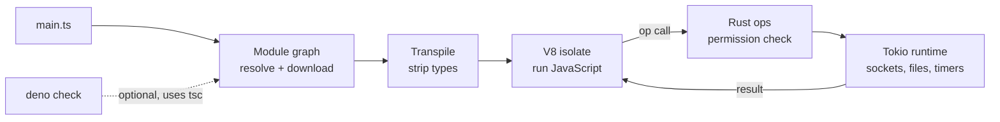

### 1.1 What Deno Is and the Problem It Solves

Deno is a JavaScript, TypeScript and WebAssembly runtime built on V8 and written in Rust. Ryan Dahl, who created Node.js, started it in 2018 to fix design choices he regretted in Node: unrestricted access to the file system and network for every package, a module system built around `node_modules` and `require`, and a toolchain spread across dozens of third-party packages.

Deno 2 keeps those goals and adds the piece that held adoption back: it runs most npm packages and Node built-ins (`node:fs`, `node:http`) directly. The result is a runtime that you can drop into an existing JavaScript codebase but that defaults to a stricter, standards-first model:

- **Default-deny permissions.** A script cannot read files, open sockets, read environment variables or spawn processes unless you grant it. Stage 2 covers this.
- **TypeScript as a first-class input.** `.ts`, `.tsx` and `.mts` files run directly. Type checking is a separate, explicit step.
- **Web platform APIs.** `fetch`, `Request`, `Response`, `URL`, `URLPattern`, Web Streams, `WebSocket`, Web Crypto and `Temporal` are globals that behave as they do in browsers, so server code and edge code share one API surface.
- **One binary, many tools.** Formatter, linter, test runner, benchmark runner, coverage, documentation generator, bundler, compiler to a single executable, task runner and a language server all ship inside `deno`.
- **Built-in cloud primitives.** Deno KV (a transactional key-value store), queues and cron, covered in Stage 5.

How the three mainstream server runtimes compare in late 2026 (this replaces the old "architectural comparison matrix" and the benchmark table that listed request-per-second numbers without a reproducible setup):

| Concern | Node.js (current LTS) | Bun (current stable) | Deno (2.9) |
| :--- | :--- | :--- | :--- |
| JavaScript engine | V8 | JavaScriptCore | V8 |
| I/O layer | libuv (C) | Custom, written in Zig | Tokio (Rust) |
| Default security | Full access. An opt-in `--permission` model exists. | Full access | Default deny, per-resource grants |
| TypeScript | Type stripping for erasable syntax; `tsc` for checks | Transpiles on load; `tsc` for checks | Transpiles on load; bundled `tsc` via `deno check` |
| Package sources | npm | npm | JSR, npm, `node:` built-ins, HTTPS URLs |
| Lockfile | `package-lock.json` | `bun.lock` | `deno.lock` |
| Built-in tools | Test runner, watch mode | Test runner, bundler, package manager | fmt, lint, test, bench, coverage, doc, bundle, compile, task, LSP |
| Built-in storage | `node:sqlite` | `bun:sqlite` | Deno KV (unstable flag), `node:sqlite` |
| Single executable | SEA (experimental) | `bun build --compile` | `deno compile` |

Pick Deno when you want least-privilege execution, a zero-config TypeScript toolchain, or code that also runs on edge platforms built on web APIs. Stay on Node when you depend on native addons or tooling that only targets Node, or when your operations team already runs Node at scale; Deno can still run much of that code (see [M1](#m1-masterclass-nodejs-compatibility--migration)).

### 1.2 Runtime Architecture: V8, Rust Ops and Tokio

Deno's architecture has four layers. The old README drew them as an ASCII box; here they are as a diagram with the path a single `fetch()` call takes.

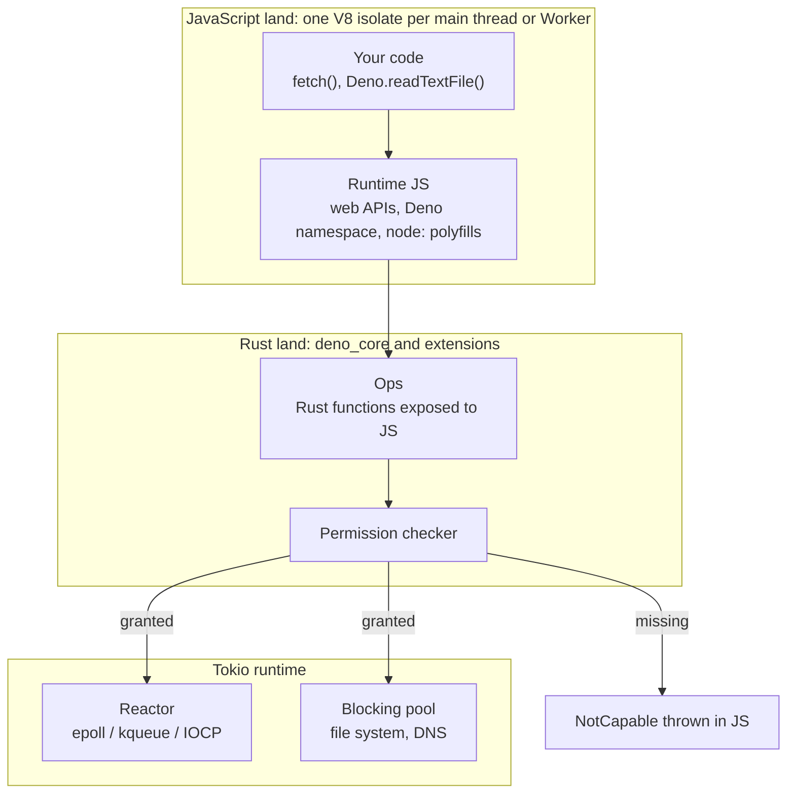

| Layer | What it is | What it does at runtime |
| :--- | :--- | :--- |
| V8 isolate | An independent JavaScript heap, call stack, microtask queue and garbage collector inside the process | Runs your code and the runtime's own JavaScript. Each `Worker` gets its own isolate, so workers share no JS objects. |
| Runtime JavaScript | The implementation of `fetch`, streams, `Deno.*` and the Node compatibility layer, mostly written in JS and TS | Validates arguments, builds web-standard objects, and calls ops for anything that touches the OS. |
| Ops (`deno_core`) | Rust functions registered with V8 that JavaScript can call. Fast ops are called through V8's fast API path with little overhead. | The only route from JavaScript to the operating system. Every op that touches a resource checks permissions first. |
| Tokio | Rust's async runtime | Waits for socket readiness through the OS (`epoll` on Linux, `kqueue` on macOS, IOCP on Windows) and runs blocking work such as file reads on a separate thread pool. |

Two consequences matter in practice. First, there is no way for JavaScript to skip the permission check, because there is no other path to a system call; the exceptions are `--allow-ffi` and `--allow-run`, which hand out native code or other processes (see [2.8](#28-threat-model-what-the-sandbox-does-and-does-not-stop)). Second, your JavaScript runs on one thread per isolate. A CPU-heavy loop blocks every request in that isolate; Tokio's threads cannot help, because they only do I/O.

**Isolates versus processes.** A process brings its own address space, file descriptor table and copy of the runtime. An isolate is a separate heap inside an existing process and starts in milliseconds with a few megabytes of memory. Platforms like Deno Deploy use this to run many tenants' code densely in one host process; [M3](#m3-masterclass-multi-tenant-isolation-with-v8-isolates) goes deeper.

### 1.3 Installation, Upgrades & Version Channels

Deno is one self-contained executable. Install it with any of these:

```bash
# macOS and Linux
curl -fsSL https://deno.land/install.sh | sh

# Windows (PowerShell)
irm https://deno.land/install.ps1 | iex

# Package managers
brew install deno          # macOS
winget install DenoLand.Deno
npm install -g deno        # where only npm is available

# Verify
deno --version
```

`deno --version` prints three versions, and all three matter:

```text
deno 2.9.8 (stable, release, x86_64-unknown-linux-gnu)
v8 15.0.245.2-rusty
typescript 6.0.3
```

The V8 version decides which JavaScript syntax and builtins exist; the TypeScript version decides what `deno check` accepts.

Keep versions consistent across laptops, CI and containers:

```bash
deno upgrade                     # latest stable
deno upgrade --version 2.9.8     # exact version
deno upgrade rc                  # release candidate channel
deno upgrade canary              # nightly builds from main
```

| Place | How to pin | Example |
| :--- | :--- | :--- |
| Local machine | `deno upgrade --version` or a version manager reading `.dvmrc` | `echo 2.9.8 > .dvmrc` |
| GitHub Actions | `denoland/setup-deno@v2` with `deno-version` | `deno-version: v2.x` (this repo) or `lts` |
| Docker | Image tag | `FROM denoland/deno:2.9.8` (this repo's [Dockerfile](./Dockerfile)) |

Editor support comes from the language server built into the binary (`deno lsp`). In VS Code install the official Deno extension and enable it per workspace, otherwise the TypeScript extension will complain that `Deno` is not defined and that imports ending in `.ts` are invalid.

### 1.4 Running Code: `run`, `serve`, `watch`, `eval` and `repl`

Deno has several entry points. They differ in what they expect your module to export and how they treat the process.

```typescript
// examples/stage1/hello.ts
interface RuntimeInfo {
  deno: string;
  v8: string;
  typescript: string;
  os: typeof Deno.build.os;
}

function describeRuntime(): RuntimeInfo {
  return {
    deno: Deno.version.deno,
    v8: Deno.version.v8,
    typescript: Deno.version.typescript,
    os: Deno.build.os,
  };
}

if (import.meta.main) {
  const info = describeRuntime();
  console.log(`Deno ${info.deno} on ${info.os}`);
  console.table(info);
  console.log("main module:", import.meta.filename ?? import.meta.url);
}
```

```bash
deno run examples/stage1/hello.ts
```

No permission flags are needed: reading `Deno.version` and `Deno.build` touches no resource. `import.meta.main` is `true` only when this file is the entry point, so the same module can be imported by a test without printing anything. `import.meta.filename` is the absolute path for local files and `undefined` for remote ones.

| Command | Use it for | Notes |
| :--- | :--- | :--- |
| `deno run file.ts` | Scripts and servers you start yourself | Also runs tasks: `deno run start` looks up a task named `start` when no file matches. |
| `deno serve file.ts` | Modules that `export default { fetch(req) { ... } }` | Deno owns the listener. `--port`, `--host` (defaults to `0.0.0.0`) and `--parallel` (one isolate per CPU, sharing the port) come for free. |
| `deno watch file.ts` | Development | Restarts or hot-replaces modules on change. Same as `deno run --watch`. |
| `deno eval "code"` | One-liners | `deno eval 'console.log(crypto.randomUUID())'` |
| `deno repl` | Exploring APIs | Accepts permission flags: `deno repl --allow-net`. |
| `deno x pkg` / `dx pkg` | Running a CLI from npm or JSR without installing it | Deno's answer to `npx`. |

The `deno serve` form, for comparison with the starter's explicit `Deno.serve()` call:

```typescript
// serve_example.ts -- run with: deno serve --port 8000 serve_example.ts
export default {
  fetch(req: Request): Response {
    const { pathname } = new URL(req.url);
    return Response.json({ pathname, at: new Date().toISOString() });
  },
} satisfies Deno.ServeDefaultExport;
```

`deno serve` grants itself network access for the port it binds, so the file above needs no `--allow-net`. The starter uses `deno run` with `Deno.serve()` instead, because it also needs a `healthcheck` subcommand and a SIGTERM handler, which are easier to wire up when you own `main`.

### 1.5 TypeScript Without a Build Step

When you run a `.ts` file, Deno does not type-check it. It parses the file with SWC (through the `deno_ast` crate), removes the type annotations, caches the JavaScript output, and runs that. Type checking is done by the real TypeScript compiler, which is bundled in the binary and invoked by `deno check`.

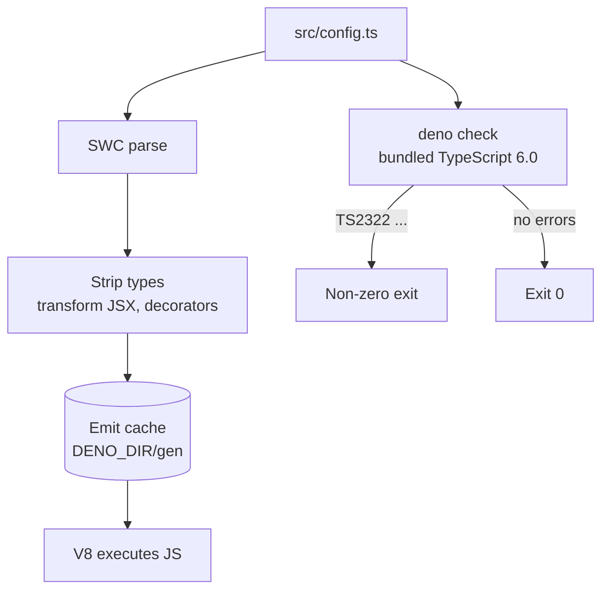

This split keeps startup fast, but it means a type error does not stop `deno run`:

```typescript
// bad.ts
const port: number = "8000";
console.log(port);
```

```text
$ deno run bad.ts
8000

$ deno check bad.ts
Check bad.ts
TS2322 [ERROR]: Type 'string' is not assignable to type 'number'.
const port: number = "8000";
      ^^^^
    at file:///tmp/bad.ts:1:7

error: Type checking failed.
```

Which commands check types by default:

| Command | Type-checks? | Override |
| :--- | :--- | :--- |
| `deno run`, `deno serve`, `deno watch`, `deno eval` | No | `--check` to turn it on |
| `deno test`, `deno bench` | Yes, local modules | `--no-check` |
| `deno compile` | Yes | `--no-check` |
| `deno check` | Yes; with no arguments it checks the whole project (`deno check .`) | `--check-js` to include `.js` files |

Defaults differ from a fresh `tsconfig.json`: `strict` is on, and Deno also enables `noImplicitOverride` and `useUnknownInCatchVariables`. Compiler options go under `"compilerOptions"` in `deno.json`; Deno also reads a `tsconfig.json` at the workspace root, which helps when a frontend toolchain shares the repo.

Because types are stripped rather than compiled, avoid TypeScript features that generate runtime code where you can (`enum`, `namespace` with values, parameter properties). They work in Deno, but code that sticks to erasable syntax also runs under Node's type stripping and moves between runtimes with no changes. The starter uses `as const` arrays and union types instead of an `enum` for this reason (see `ITEM_STATUSES` in [src/types.ts](./src/types.ts)).

### 1.6 The Event Loop in Practice

One thread runs your JavaScript. It drains synchronous code first, then every queued microtask (promise callbacks, `queueMicrotask`), then picks the next macrotask (a timer, an I/O completion from Tokio). Knowing this order explains most "why did that log line come first" questions.

```typescript
// examples/stage1/event_loop.ts
const order: string[] = [];

setTimeout(() => order.push("4. timer (macrotask)"), 0);
queueMicrotask(() => order.push("2. queueMicrotask"));
Promise.resolve().then(() => order.push("3. promise.then"));
order.push("1. synchronous code");

// An async op: the promise settles on a later loop turn.
await new Promise<void>((resolve) => setTimeout(resolve, 10));
order.push("5. after awaiting a 10 ms timer");

console.log(order.join("\n"));
```

```text
$ deno run examples/stage1/event_loop.ts
1. synchronous code
2. queueMicrotask
3. promise.then
4. timer (macrotask)
5. after awaiting a 10 ms timer
```

The file uses top-level `await`, which is allowed in any ES module. The process exits when the loop has nothing left to wait for: no pending timers, no open listeners, no in-flight ops. That is why a server started with `Deno.serve()` keeps running and a script whose last promise settled exits on its own.

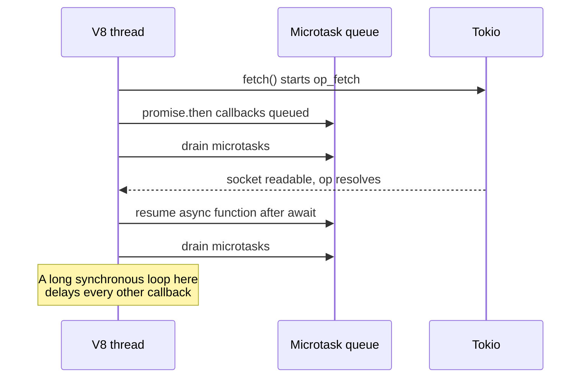

Since 2.6 Deno uses Node.js-compatible timers by default, so `setTimeout` returns a `Timeout` object rather than a number. Code that stores timer ids in a `number` variable should use `ReturnType<typeof setTimeout>`.

### 1.7 Line-by-Line Breakdown of the Starter Project

The starter in this repo is a small JSON API for to-do style items. It exercises Stage 1 (running, checking, testing), Stage 2 (a permission set) and Stage 3 (a `deno.json` with an import map, tasks and a lockfile).

```text
learn-deno/
├── deno.json            tasks, permission set, imports, lint/fmt/test config
├── deno.lock            exact dependency versions and integrity hashes
├── src/
│   ├── main.ts          entry point: config, Deno.serve, healthcheck, SIGTERM
│   ├── server.ts        createHandler(store): routing with URL and URLPattern
│   ├── store.ts         ItemStore interface and MemoryItemStore
│   ├── validation.ts    parseNewItem(): unknown -> NewItem or an error
│   ├── config.ts        loadConfig(env): PORT parsing
│   └── types.ts         Item, NewItem, ItemStatus, HealthReport
├── tests/               *_test.ts, run with deno test (no permissions)
└── examples/            the runnable snippets from Stages 1-3
```

The entry point, [src/main.ts](./src/main.ts):

```typescript
import { loadConfig } from "./config.ts";
import { createHandler } from "./server.ts";
import { MemoryItemStore, SAMPLE_ITEMS } from "./store.ts";

/** `server healthcheck` exits 0 when the running server answers /health. */
async function healthcheck(port: number): Promise<number> {
  try {
    const res = await fetch(`http://127.0.0.1:${port}/health`);
    await res.body?.cancel();
    return res.ok ? 0 : 1;
  } catch {
    return 1;
  }
}

if (import.meta.main) {
  const config = loadConfig(Deno.env);

  if (Deno.args[0] === "healthcheck") {
    Deno.exit(await healthcheck(config.port));
  }

  const store = new MemoryItemStore({ seed: SAMPLE_ITEMS });
  const server = Deno.serve({
    hostname: config.hostname,
    port: config.port,
    onListen: ({ hostname, port }) => {
      console.log(`learn-deno listening on http://${hostname}:${port}`);
    },
  }, createHandler(store));

  // Docker sends SIGTERM on stop. Finish in-flight requests, then exit.
  if (Deno.build.os !== "windows") {
    Deno.addSignalListener("SIGTERM", () => {
      console.log("SIGTERM received, draining connections");
      server.shutdown();
    });
  }

  await server.finished;
}
```

| Line / API | Role | What happens at runtime |
| :--- | :--- | :--- |
| `import { loadConfig } from "./config.ts"` | Relative import with the extension | Deno requires the `.ts` extension; there is no extension guessing for local files. |
| `if (import.meta.main)` | Entry-point guard | Lets tests import this module without starting a server. |
| `loadConfig(Deno.env)` | Reads `PORT` | Needs `--allow-env=PORT`. Without it the call throws `NotCapable` (see [1.9](#19-pitfalls)). |
| `Deno.args[0] === "healthcheck"` | Subcommand for Docker's `HEALTHCHECK` | The distroless image has no `curl`, so the binary checks itself. |
| `fetch("http://127.0.0.1:...")` | Calls the running server | Needs net access to `127.0.0.1`, which is in the permission set. |
| `await res.body?.cancel()` | Releases the response body | An unread body keeps the connection resource open. |
| `Deno.serve({ hostname, port, onListen }, handler)` | Starts the HTTP server | Binds `0.0.0.0:8000`, needs net access to `0.0.0.0`, and returns a `Deno.HttpServer`. |
| `Deno.addSignalListener("SIGTERM", ...)` | Graceful shutdown | Without it, a process running as PID 1 in a container ignores SIGTERM and Docker kills it after 10 seconds. |
| `server.shutdown()` | Stop accepting, drain in-flight requests | Resolves `server.finished` when the last response is sent. |
| `await server.finished` | Keeps `main` alive until shutdown | Lets code after it run cleanup, such as closing a KV handle. |

The request handler in [src/server.ts](./src/server.ts) is a function from `Request` to `Promise<Response>`. That type is the whole HTTP contract in Deno, which is why the tests can call it directly:

```typescript
const ITEMS_PATH = "/api/v1/items";
const ITEM_BY_ID = new URLPattern({ pathname: `${ITEMS_PATH}/:id` });

export function createHandler(
  store: ItemStore,
  startedAt: number = performance.now(),
): Handler {
  async function route(req: Request): Promise<Response> {
    const url = new URL(req.url);
    // ... "/" and "/health" and "/api/v1/items" handled with plain comparisons
    const match = ITEM_BY_ID.exec(url);
    if (match) {
      const id = match.pathname.groups.id ?? "";
      // GET -> 200 or 404, DELETE -> 204 or 404, anything else -> 405
    }
    return errorResponse(404, `No route for ${req.method} ${pathname}`);
  }

  return async (req) => {
    const start = performance.now();
    let res: Response;
    try {
      res = await route(req);
    } catch (err) {
      console.error("unhandled error", err);
      res = errorResponse(500, "Internal server error");
    }
    res.headers.set("X-Response-Time-Ms", (performance.now() - start).toFixed(2));
    return res;
  };
}
```

| Line / API | Role | What happens at runtime |
| :--- | :--- | :--- |
| `new URLPattern({ pathname: ".../:id" })` | Web-standard route matcher | Compiled once at module load; `exec()` returns named groups or `null`. |
| `createHandler(store, startedAt)` | Factory with injected dependencies | Tests pass a fresh `MemoryItemStore`; production passes a seeded one. Stage 5 passes a KV-backed store. |
| `Response.json(data, init)` | Builds a JSON response | Serialises and sets `content-type: application/json`. |
| `try { ... } catch` around `route` | Last-resort error boundary | An exception becomes a 500 instead of an aborted connection, and is logged once. |
| `res.headers.set(...)` | Timing header | Headers on a `Response` you created are mutable. |

The earlier version of the starter generated ids with `String(this.store.size + 1)`. After a delete, the next id collided with an existing item and silently overwrote it. [src/store.ts](./src/store.ts) now uses `crypto.randomUUID()`, and `tests/store_test.ts` keeps a regression test for that bug.

Run it:

```bash
deno task start
# learn-deno listening on http://0.0.0.0:8000

curl -s localhost:8000/health
# {"status":"ok","deno":"2.9.8","v8":"15.0.245.2-rusty","typescript":"6.0.3",...}

curl -s -X POST localhost:8000/api/v1/items \
  -H 'content-type: application/json' -d '{"title":"Finish Stage 1"}'
```

### 1.8 The All-in-One Toolchain

Every tool below ships in the `deno` binary and reads its settings from `deno.json`. The starter's CI job runs the first five in that order.

| Tool | Replaces | Starter usage | Useful flags |
| :--- | :--- | :--- | :--- |
| `deno fmt` | Prettier | `deno fmt --check` in CI | `--watch`; formats TS, JS, JSON, Markdown, CSS, HTML, YAML |
| `deno lint` | ESLint (for most rules) | `deno lint` | `--fix`, `--rules`; JS plugins since 2.2 |
| `deno check` | `tsc --noEmit` | `deno check` | `--watch` (2.8+), `--doc` to check code in JSDoc and Markdown |
| `deno test` | Jest, Vitest, Mocha | `deno test` | `--filter`, `--parallel`, `--coverage`, `--shard`, `--doc` |
| `deno compile` | `pkg`, `nexe` | `deno task compile` | `--target`, `--include`, `-P` |
| `deno info` | `npm ls` plus module graph view | `deno info src/main.ts` | `--json` |
| `deno doc` | TypeDoc | `deno doc src/store.ts` | `--html`, `--lint` |
| `deno bench` | Benchmark.js, tinybench | Stage 6 | `--filter`, `--json` |
| `deno coverage` | c8, nyc | Stage 6 | `--lcov`, `--html` |
| `deno task` | npm scripts | `deno task ci` | `--recursive` in workspaces |

`deno info` prints the module graph, which is the quickest way to see why a file is being loaded:

```text
$ deno info src/main.ts
local: /app/src/main.ts
type: TypeScript
dependencies: 5 unique
size: 9.5KB

file:///app/src/main.ts (1.15KB)
├── file:///app/src/config.ts (799B)
├─┬ file:///app/src/server.ts (3.32KB)
│ ├─┬ file:///app/src/store.ts (2KB)
│ │ └── file:///app/src/types.ts (690B)
│ ├── file:///app/src/types.ts *
│ └─┬ file:///app/src/validation.ts (1.58KB)
│   └── file:///app/src/types.ts *
└── file:///app/src/store.ts *
```

A test is any function registered with `Deno.test` in a file named `*_test.ts`, `*.test.ts` or under the folders listed in `"test.include"`. Steps (`t.step`) group related assertions and report separately:

```typescript
// tests/validation_test.ts (excerpt)
import { assertEquals } from "@std/assert";
import { parseNewItem } from "../src/validation.ts";

Deno.test("parseNewItem applies defaults and trims the title", () => {
  assertEquals(parseNewItem({ title: "  Learn JSR  " }), {
    ok: true,
    value: { title: "Learn JSR", description: "", status: "pending" },
  });
});
```

```text
$ deno test
ok | 14 passed (13 steps) | 0 failed (903ms)
```

The suite runs with no permission flags at all. `tests/config_test.ts` passes a fake `EnvReader` instead of `Deno.env`, and the server tests call the handler directly instead of opening a port. Designing for that is the cheapest way to keep tests fast and the permission surface small.

### 1.9 Pitfalls

| Pitfall | Symptom | Fix |
| --- | --- | --- |
| Running a server without permissions | `error: Uncaught (in promise) NotCapable: Requires env access to "PORT", run again with the --allow-env flag` | Grant exactly what is named: `--allow-env=PORT`, or use the starter's `deno task start` (`-P`). |
| Expecting `deno run` to catch type errors | Code with a wrong type runs and fails later, or not at all | Run `deno check` in CI and in a pre-commit hook; `deno test` checks too. |
| Omitting the `.ts` extension in a relative import | `error: Module not found "file:///app/src/config". Maybe add a '.ts' extension or run with --sloppy-imports` | Write `./config.ts`. `--sloppy-imports` exists for migrating old code, not for new code. |
| CPU-heavy work in a request handler | Latency spikes for every request while one request computes | Move it to a `Worker`, precompute it, or push it to a queue (Stage 5). |
| Forgetting to consume or cancel a response body | Leaked connections; with `--sanitize-resources` the test fails with a leak report | `await res.text()`, `await res.json()` or `await res.body?.cancel()`. |
| Using `window` from old Deno 1 or browser code | `ReferenceError: window is not defined` | Use `globalThis` (or `self` in workers). |
| Storing `setTimeout` ids as `number` | `TS2322: Type 'Timeout' is not assignable to type 'number'` | `let id: ReturnType<typeof setTimeout>`. |
| VS Code shows `Cannot find name 'Deno'` | Red squiggles everywhere, but `deno check` passes | Enable the Deno extension for the workspace (`deno.enable: true`). |

### 1.10 Best Practices

- **Pin the Deno version in three places (local, CI, Docker):** a minor upgrade can change defaults, as 2.8 did for test sanitizers and 2.9 did for compression.
- **Run `deno fmt --check`, `deno lint`, `deno check`, `deno test` on every push:** they are fast, built in, and catch different classes of mistakes.
- **Guard entry points with `import.meta.main`:** the module stays importable by tests and other modules.
- **Inject `Deno.env`, the clock and id generators:** tests stay deterministic and need no permissions.
- **Prefer erasable TypeScript syntax:** union types and `as const` instead of `enum` keep code portable across runtimes that strip types.
- **Handle SIGTERM in servers:** containers and orchestrators stop processes with it, and draining avoids dropped requests.
- **Read `deno --version` output in bug reports:** the V8 and TypeScript versions explain most "works on my machine" differences.

### 1.11 Hands-on Exercise

Add a `GET /api/v1/items?status=completed` filter to the starter.

1. In [src/server.ts](./src/server.ts), read `url.searchParams.get("status")` in the `GET /api/v1/items` branch. Validate it with `isItemStatus` from [src/validation.ts](./src/validation.ts) and return `400` with `status must be one of: pending, in_progress, completed` when it is invalid.
2. Filter the list before building the response, so `total` counts only matching items.
3. Add a test to [tests/server_test.ts](./tests/server_test.ts) that creates one pending and one completed item and asserts that `?status=completed` returns exactly one item.

Expected output:

```text
$ deno test --filter "status filter"
ok | 1 passed | 0 failed
$ deno check && deno lint
```

The validation helper you need already exists; the solution is about ten lines in the handler and fifteen in the test.

[Back to top ⤴️](#-table-of-contents)

---

## 2. Stage 2: The Security Model & Permissions

In Node.js or Python, any dependency you install can read `~/.ssh`, dump environment secrets or open a socket to any host, because the process has every right the user has. Deno starts every program with no access to files, network, environment, subprocesses, OS information or native libraries, and makes you grant each one. This stage covers the flags, the permission sets in `deno.json` that the starter uses, the runtime API, how permissions apply to tests, workers and compiled binaries, and where the sandbox stops protecting you. Afterwards you can run any service with the smallest grant that works and prove it in CI.

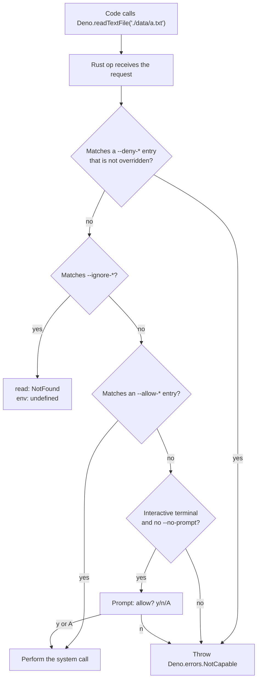

### 2.1 Default-Deny: the Capability Model

A capability is a right to touch one kind of resource. Deno has eight kinds, and each op checks the one it needs before calling the operating system. The check happens in Rust, below all JavaScript, so no library can reach around it by monkey-patching a global or importing a hidden module.

Run the starter's entry point with no flags and no terminal prompt:

```text
$ deno run --no-prompt src/main.ts
error: Uncaught (in promise) NotCapable: Requires env access to "PORT", run again with the --allow-env flag
  const raw = env.get("PORT");
                  ^
    at Object.getEnv [as get] (ext:deno_os/30_os.js:1:1291)
    at loadConfig (file:///app/src/config.ts:18:19)
    at file:///app/src/main.ts:17:18
```

The error names the resource (`"PORT"`), the flag that would grant it, and the line that asked. That makes granting the smallest permission mechanical: read the message, add exactly that resource, run again.

Since Deno 2.0 a missing permission throws `Deno.errors.NotCapable`. `Deno.errors.PermissionDenied` now means only what it means everywhere else: the operating system refused (for example, a file owned by root). Code written for Deno 1 that catches `PermissionDenied` to detect a sandbox block must check `NotCapable` instead.

Some things need no permission at all: pure computation, reading `Deno.version`, `Deno.build` and `Deno.args`, `Deno.cwd()` (since 2.2), `Deno.execPath()` (since 2.4), importing local modules, and importing from JSR and npm. A program that only transforms its inputs can run with zero flags, which is the strongest guarantee the sandbox offers.

### 2.2 Permission Flags Reference

This table expands the one in the earlier README with the short flags, `--allow-import` (added in 2.0) and the `--deny-*` and `--ignore-*` families.

| Permission | Allow flag | Scope with a list | Example | Notes |
| :--- | :--- | :--- | :--- | :--- |
| File read | `-R`, `--allow-read` | Paths (files or directories) | `--allow-read=./config,/etc/ssl/certs` | Directory grants include everything below them. |
| File write | `-W`, `--allow-write` | Paths | `--allow-write=./logs,/tmp` | Writing to `deno.json` or your own source files is equivalent to granting more permissions next run. |
| Network | `-N`, `--allow-net` | Hosts, `host:port`, IPs, CIDR ranges (2.4), `*.domain` (2.4) | `--allow-net=api.stripe.com,0.0.0.0:8000` | One flag covers both listening and outbound connections. |
| Environment | `-E`, `--allow-env` | Variable names, `PREFIX_*` wildcards | `--allow-env=PORT,AWS_*` | `NO_COLOR` and `FORCE_COLOR` are readable without it. |
| OS info | `-S`, `--allow-sys` | API names | `--allow-sys=hostname,systemMemoryInfo` | Names match the `Deno.*` function, for example `osRelease`, `loadavg`, `networkInterfaces`. |
| Subprocess | `--allow-run` | Program names or paths | `--allow-run=git,ffmpeg` | A subprocess runs outside the sandbox. |
| Native code | `--allow-ffi` | Library paths | `--allow-ffi=./libsum.so` | Still marked unstable. Native code runs outside the sandbox. |
| Remote import | `-I`, `--allow-import` | Hosts | `--allow-import=example.com` | Needed for HTTPS imports from hosts outside the built-in list (`jsr.io`, `deno.land`, `esm.sh`, `raw.esm.sh`, `cdn.jsdelivr.net`, `raw.githubusercontent.com`, `gist.githubusercontent.com`, all on port 443). |
| Everything | `-A`, `--allow-all` | - | `-A` | Turns the sandbox off. Fine for one-off local scripts, never for services. |

Each allow flag has a matching `--deny-<name>` flag. `--ignore-read` and `--ignore-env` (2.6) make access fail quietly instead of loudly: an ignored file reads as `NotFound`, an ignored variable reads as `undefined`. Use ignore for libraries that probe for optional config you do not want to share.

Two extra switches change how missing permissions are handled:

| Switch | Effect |
| :--- | :--- |
| `--no-prompt` | Never ask; throw `NotCapable` straight away. Prompts only appear on an interactive TTY, but pass this in scripts and CI anyway so behaviour does not depend on how a job was started. |
| `DENO_TRACE_PERMISSIONS=1` | Adds a stack trace to every permission prompt and error, showing which call (often deep inside a dependency) asked. |
| `DENO_AUDIT_PERMISSIONS=./audit.jsonl` | Logs every permission check as JSON lines (or as OpenTelemetry log events with `=otel`). Run your test suite with it to build an accurate allow list. |

### 2.3 Scoping Permissions: Allow, Deny and Ignore Together

Real services need a broad grant with a few holes in it: read the data directory, but not the secrets inside it. The three flag families combine, and the more specific rule wins.

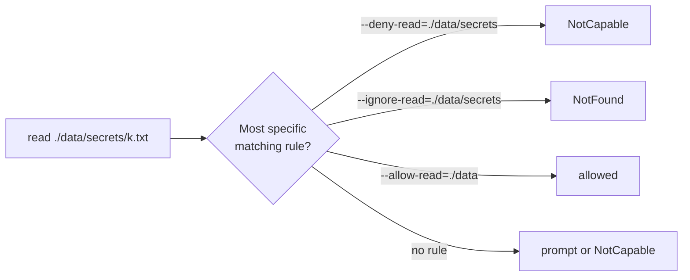

Real output from Deno 2.9 with `./data/a.txt` and `./data/secrets/k.txt` present, using this probe:

```typescript
// read_probe.ts
for (const p of ["./data/a.txt", "./data/secrets/k.txt"]) {
  try {
    console.log(p, "->", (await Deno.readTextFile(p)).trim());
  } catch (e) {
    console.log(p, "->", `${(e as Error).name}: ${(e as Error).message}`);
  }
}
```

```text
$ deno run --no-prompt --allow-read=./data --deny-read=./data/secrets read_probe.ts
./data/a.txt -> pub
./data/secrets/k.txt -> NotCapable: Requires read access to "./data/secrets/k.txt", run again with the --allow-read flag

$ deno run --no-prompt --allow-read=./data --ignore-read=./data/secrets read_probe.ts
./data/a.txt -> pub
./data/secrets/k.txt -> NotFound: No such file or directory (os error 2)

$ deno run --no-prompt --deny-read=./data --allow-read=./data/a.txt read_probe.ts
./data/a.txt -> pub
./data/secrets/k.txt -> NotCapable: Requires read access to "./data/secrets/k.txt", run again with the --allow-read flag
```

The third run shows the 2.6 rule: an allow entry that is more specific than a deny entry wins. Before 2.6, any matching deny won, so the same command would have blocked `a.txt` too.

Network grants follow the same idea. A bare host allows every port on it; `host:port` allows one port; `*.github.com` allows every subdomain; `10.0.0.0/8` allows a range. The starter grants `0.0.0.0` (so it can listen on whatever `PORT` says) and `127.0.0.1` (for its own healthcheck), and nothing outbound.

### 2.4 Permission Sets in `deno.json`

Flags on a command line get copied into READMEs, Dockerfiles, CI files and shell aliases, and then drift. Since 2.5 you can name sets of permissions in `deno.json` and load one with `-P` (or `--permission-set=<name>`). The starter's [deno.json](./deno.json):

```json
{
  "tasks": {
    "start": "deno run -P src/main.ts",
    "dev": "deno run -P --watch src/main.ts",
    "test": "deno test",
    "compile": "deno compile -P --output dist/server src/main.ts"
  },
  "permissions": {
    "default": {
      "net": ["0.0.0.0", "127.0.0.1"],
      "env": ["PORT"]
    }
  },
  "compile": {
    "permissions": "default"
  }
}
```

| Key | Role | What happens at runtime |
| :--- | :--- | :--- |
| `"permissions"` | Map of named sets | Not applied on its own; something has to select a set. |
| `"default"` | The set `-P` loads when you give no name | `deno run -P src/main.ts` behaves like `--allow-net=0.0.0.0,127.0.0.1 --allow-env=PORT`. |
| `"net": [...]` / `"env": [...]` | Array form | Same values the CLI flags take. `true` means unrestricted, `false` means deny. |
| `"compile": { "permissions": "default" }` | Permissions baked into `deno compile` output | `deno compile` now refuses to run without `-P` or explicit flags, so you cannot forget them. |

The object form expresses allow, deny and ignore in one place:

```json
{
  "permissions": {
    "worker": {
      "read": {
        "allow": ["./data"],
        "deny": ["./data/secrets"],
        "ignore": ["./data/cache"]
      },
      "env": { "allow": ["DATABASE_URL", "OTEL_*"] },
      "net": ["db.internal:5432", "otel-collector:4318"]
    }
  }
}
```

```bash
deno run -P=worker src/worker.ts
```

When `test`, `bench` or `compile` declares permissions, running that command without `-P` or a flag is an error rather than a silent run with no permissions:

```text
$ deno compile --output /tmp/server src/main.ts
error: Compile permissions were found in the config file. Did you mean to run with `-P` or a permission flag?
    at file:///app/deno.json
```

Deno prints `Warning Permissions in the config file is an experimental feature and may change in the future.` when you use `-P`. Keep the flags in the config anyway: one source of truth is worth an occasional rename if the format changes.

**Security note.** A permission set is only as trustworthy as `deno.json`. Anything that can write to the config can widen its own permissions on the next run, which is why `--allow-write` should never include the project root of a long-running service.

### 2.5 The Runtime Permissions API

`Deno.permissions` lets a program inspect and change its own grants. The three calls follow the browser Permissions API shape:

| Call | Returns | Use it for |
| :--- | :--- | :--- |
| `query(desc)` | `PermissionStatus` with `state`: `"granted"`, `"prompt"` or `"denied"` | Feature detection: enable a cache directory only if it is writable. |
| `request(desc)` | The new status, after prompting if possible | CLIs that ask the user just before they need access. Without a TTY or with `--no-prompt` it returns `"denied"`. |
| `revoke(desc)` | The new status | Dropping a right after startup. There is no way to get it back without a prompt. |

Each has a `*Sync` twin (`querySync` and so on). The probe in [examples/stage2/permissions_probe.ts](./examples/stage2/permissions_probe.ts):

```typescript
const probes: Deno.PermissionDescriptor[] = [
  { name: "env", variable: "HOME" },
  { name: "read", path: "." },
  { name: "write", path: "/tmp" },
  { name: "net", host: "jsr.io:443" },
  { name: "run", command: "git" },
  { name: "sys", kind: "hostname" },
];

for (const descriptor of probes) {
  const status = await Deno.permissions.query(descriptor);
  console.log(`${JSON.stringify(descriptor).padEnd(40)} ${status.state}`);
}

try {
  Deno.env.get("HOME");
  console.log("HOME is readable");
} catch (err) {
  if (err instanceof Deno.errors.NotCapable) {
    console.log(`blocked: ${err.message}`);
  } else {
    throw err;
  }
}
```

```text
$ deno run --no-prompt --allow-env=HOME --allow-read=. examples/stage2/permissions_probe.ts
{"name":"env","variable":"HOME"}         granted
{"name":"read","path":"."}               granted
{"name":"write","path":"/tmp"}           prompt
{"name":"net","host":"jsr.io:443"}       prompt
{"name":"run","command":"git"}           prompt
{"name":"sys","kind":"hostname"}         prompt
HOME is readable
```

`"prompt"` means "not granted yet"; whether a prompt would actually appear depends on the terminal and `--no-prompt`.

Revoking after startup applies least privilege over time, the pattern the old README showed with `/etc/passwd`. Here it is as a runnable file, [examples/stage2/drop_permissions.ts](./examples/stage2/drop_permissions.ts):

```typescript
await Deno.mkdir("./tmp-demo", { recursive: true });
await Deno.writeTextFile(
  "./tmp-demo/boot.log",
  `booted ${new Date().toISOString()}\n`,
);

const revoked = await Deno.permissions.revoke({ name: "write" });
console.log("write permission is now:", revoked.state);

try {
  await Deno.writeTextFile("./tmp-demo/late.log", "too late\n");
} catch (err) {
  console.log("late write blocked:", err instanceof Deno.errors.NotCapable);
}
```

```text
$ deno run --allow-read=. --allow-write=./tmp-demo examples/stage2/drop_permissions.ts
write permission is now: prompt
late write blocked: true
```

A typical server does this after it has written a PID file, opened its log file or warmed a cache, so a later request-handling bug cannot write anywhere.

### 2.6 Handling `NotCapable` and Prompts

Permission failures are ordinary exceptions, so they compose with normal error handling. Decide per call site whether a missing permission is fatal or a feature you can turn off.

```typescript
// optional_cache.ts
// Run: deno run --allow-read=./cache --allow-write=./cache optional_cache.ts
// or without the flags, and the program still works, just slower.

async function openCacheDir(path: string): Promise<string | null> {
  const status = await Deno.permissions.query({ name: "write", path });
  if (status.state !== "granted") return null;
  await Deno.mkdir(path, { recursive: true });
  return path;
}

async function readThroughCache(key: string, compute: () => Promise<string>) {
  const dir = await openCacheDir("./cache");
  const file = dir ? `${dir}/${encodeURIComponent(key)}.txt` : null;

  if (file) {
    try {
      return await Deno.readTextFile(file);
    } catch (err) {
      if (!(err instanceof Deno.errors.NotFound)) throw err;
    }
  }

  const value = await compute();
  if (file) await Deno.writeTextFile(file, value);
  return value;
}

console.log(await readThroughCache("answer", () => Promise.resolve("42")));
```

The function queries before acting instead of catching `NotCapable`, because a query never prompts. Catching is the right tool when the resource name is only known at the call site, for example a user-supplied path.

What the interactive prompt offers when a TTY is attached:

```text
┏ ⚠️  Deno requests read access to "./data/a.txt".
┠─ Requested by `Deno.readFile()` API.
┠─ To see a stack trace for this prompt, set the DENO_TRACE_PERMISSIONS environmental variable.
┠─ Learn more at: https://docs.deno.com/go/--allow-read
┠─ Run again with --allow-read to bypass this prompt.
┗ Allow? [y/n/A] (y = yes, allow; n = no, deny; A = allow all read permissions) >
```

Answering `A` grants the whole category for the rest of the run. Prompts are a development convenience; production code should never depend on one, which is why CI and containers run with `--no-prompt` or a fully specified set.

### 2.7 Permissions in Tests, Workers and Compiled Binaries

Permissions nest. A child can have fewer rights than its parent but never more, and asking for more is an error.

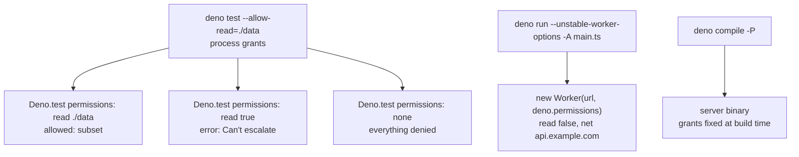

**Tests.** `Deno.test` accepts a `permissions` object, applied for that test only:

```typescript
// tests that need a fixture directory
Deno.test({
  name: "loads fixtures",
  permissions: { read: ["./tests/fixtures"] },
  async fn() {
    const text = await Deno.readTextFile("./tests/fixtures/item.json");
    JSON.parse(text);
  },
});

Deno.test({
  name: "pure logic runs with nothing",
  permissions: "none",
  fn() {
    // any Deno.readTextFile here would throw NotCapable
  },
});
```

If the process was not started with at least that grant, the test fails instead of silently widening access:

```text
$ deno test --no-prompt tests/fixtures_test.ts
loads fixtures ... FAILED (2ms)
error: NotCapable: Can't escalate parent thread permissions
```

The starter avoids the problem entirely: every test runs with zero permissions because the code under test takes its dependencies as parameters.

**Workers.** A `Worker` can run with a smaller set than its parent, which is how you isolate a plugin or a parser of untrusted input inside one process. The option is still unstable:

```typescript
// main.ts -- deno run --unstable-worker-options --allow-read --allow-net main.ts
const worker = new Worker(new URL("./parser_worker.ts", import.meta.url), {
  type: "module",
  deno: {
    permissions: {
      read: false,
      net: false,
      env: false,
    },
  },
});

worker.onmessage = (event) => {
  console.log("parsed:", event.data);
  worker.terminate();
};
worker.postMessage("title=Ship it&status=pending");
```

```typescript
// parser_worker.ts
/// <reference lib="deno.worker" />
self.onmessage = (event: MessageEvent<string>) => {
  const params = new URLSearchParams(event.data);
  self.postMessage(Object.fromEntries(params));
};
```

Without `--unstable-worker-options` Deno refuses: `Unstable API 'Worker.deno.permissions'. The --unstable-worker-options flag must be provided.`

**Compiled binaries.** `deno compile` writes the permission set into the executable. The starter's Docker image runs a binary compiled with `-P`, so the container can listen and read `PORT`, and nothing else, even though the image has no Deno CLI to pass flags to. Flags passed to the binary at runtime are treated as program arguments, not permissions.

### 2.8 Threat Model: What the Sandbox Does and Does Not Stop

The sandbox limits what JavaScript running in Deno can do. It does not limit what happens once you hand control to something outside it.

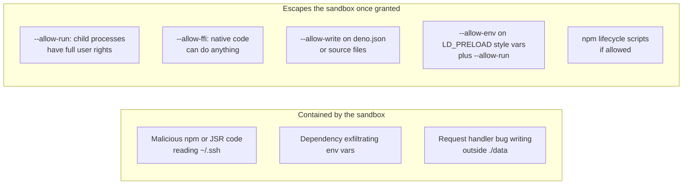

| Grant | Why it is an escape hatch | Safer alternative |
| :--- | :--- | :--- |
| `--allow-run` (no list) | Spawns any program, which runs without Deno's restrictions. `--allow-run=git` still lets `git` read any file. | List programs explicitly, or call an HTTP service instead. |
| `--allow-ffi` | Loaded libraries run native code in your process. | Wasm (runs inside V8's sandbox) when performance allows. See [M2](#m2-masterclass-ffi--webassembly). |
| `--allow-write` covering config or code | The next run loads the modified permissions or code. | Write only to a data directory outside the project. |
| `--allow-env` (no list) | Exposes every secret in the environment to every dependency. | List variable names; use `--ignore-env` for probing libraries. |
| `--allow-net` (no list) | Lets a compromised dependency send data anywhere. | List hosts; use CIDR ranges for internal networks. |
| `--allow-scripts` | npm `postinstall` scripts run as normal processes during install. | Leave scripts off; approve specific packages with `deno approve-scripts`. |

Two supply-chain controls complement permissions. `"minimumDependencyAge"` in `deno.json` refuses package versions younger than a given age, which blocks most "publish a malicious patch and hope" attacks that are caught within days. `deno audit` checks installed npm packages against advisory databases.

The sandbox does not protect against bugs in Deno itself, V8 exploits, or a malicious program that has every permission it asked for. For untrusted code from users, run it in a separate isolate with a CPU and memory budget, or in a separate process or VM ([M3](#m3-masterclass-multi-tenant-isolation-with-v8-isolates)).

### 2.9 Pitfalls

| Pitfall | Symptom | Fix |
| --- | --- | --- |
| Using `-A` in a Dockerfile or production task | Works, and gives every dependency full access to the container | Replace with a permission set; run with `DENO_AUDIT_PERMISSIONS` once to find what is used. |
| Catching `PermissionDenied` for sandbox errors | Missing permissions bypass your handler and crash the process | Catch `Deno.errors.NotCapable` (Deno 2.0+). |
| Granting `--allow-net=localhost` and binding `0.0.0.0` | `NotCapable: Requires net access to "0.0.0.0:8000"` | Grant the address you actually bind. |
| Running `deno test` when `"test.permissions"` is set | `error: Test permissions were found in the config file. Did you mean to run with -P?` | `deno test -P`, or pass explicit flags. |
| Test asks for more than the process has | `NotCapable: Can't escalate parent thread permissions` | Start `deno test` with at least the union of all per-test grants. |
| Relying on an interactive prompt in CI | The job hangs on some runners or fails with `NotCapable` on others | Always pass `--no-prompt` or a full permission set in automation. |
| `--allow-env` wildcard typed without quotes | The shell expands `AWS_*` against file names | Quote it: `--allow-env='AWS_*'`. |
| Assuming `--allow-run=git` is safe | `git` hooks, aliases and `-c core.sshCommand` can run arbitrary programs | Treat any `--allow-run` as full trust in that program and its inputs. |

### 2.10 Best Practices

- **Start from zero and add what the error names:** the `NotCapable` message tells you the exact resource to grant.
- **Keep permissions in `deno.json` permission sets:** one definition serves `deno task`, `deno compile` and the Docker image.
- **Scope every grant with a list:** an unscoped `--allow-net` or `--allow-env` is almost as broad as `-A` for an attacker.
- **Pass `--no-prompt` in scripts and CI:** behaviour then does not depend on whether a TTY was attached.
- **Write code that needs no permissions to test:** inject `Deno.env`, clocks and stores so the test suite runs with nothing granted.
- **Revoke write and run rights after startup** when the process only needs them during initialisation.
- **Treat `--allow-run`, `--allow-ffi` and write access to code as full trust:** review them the way you would review `sudo`.
- **Audit grants with `DENO_AUDIT_PERMISSIONS` before tightening them:** it shows every check your real workload performs.

### 2.11 Hands-on Exercise

Give the starter an optional request log.

1. Add an `ACCESS_LOG` environment variable that, when set, names a file the server appends one line per request to (`method path status duration`).
2. Extend the `default` permission set in [deno.json](./deno.json) with `"env": ["PORT", "ACCESS_LOG"]` and `"write": ["./logs"]`. Do not grant read access.
3. Before opening the file, call `Deno.permissions.query({ name: "write", path })`. If it is not `"granted"`, print a warning and keep serving without the log.
4. Start the server with `ACCESS_LOG=./logs/access.log deno task start`, make three requests, and confirm three lines in the file. Then run `ACCESS_LOG=/etc/access.log deno task start` and confirm you get the warning, not a crash.

Expected output for the second run:

```text
warning: ACCESS_LOG=/etc/access.log is not writable with the current permissions, request logging is off
learn-deno listening on http://0.0.0.0:8000
```

The query pattern you need is [2.6](#26-handling-notcapable-and-prompts); keep `loadConfig` testable by passing the env reader in, as [src/config.ts](./src/config.ts) does.

[Back to top ⤴️](#-table-of-contents)

---

## 3. Stage 3: Modules, Dependencies & Configuration

Deno uses ES modules only, and every import is a URL-like specifier that Deno resolves, downloads once, caches and pins in a lockfile. This stage covers the specifier kinds (`./`, `jsr:`, `npm:`, `node:`, `https:`), `deno.json` as the single config file, JSR, npm packages with and without `node_modules`, the lockfile and frozen installs, the dependency commands, workspaces, tasks and publishing. It builds on the permission model from Stage 2, because some packages need permissions you did not expect. Afterwards you can set up a reproducible single-package or multi-package Deno project and publish a library to JSR.

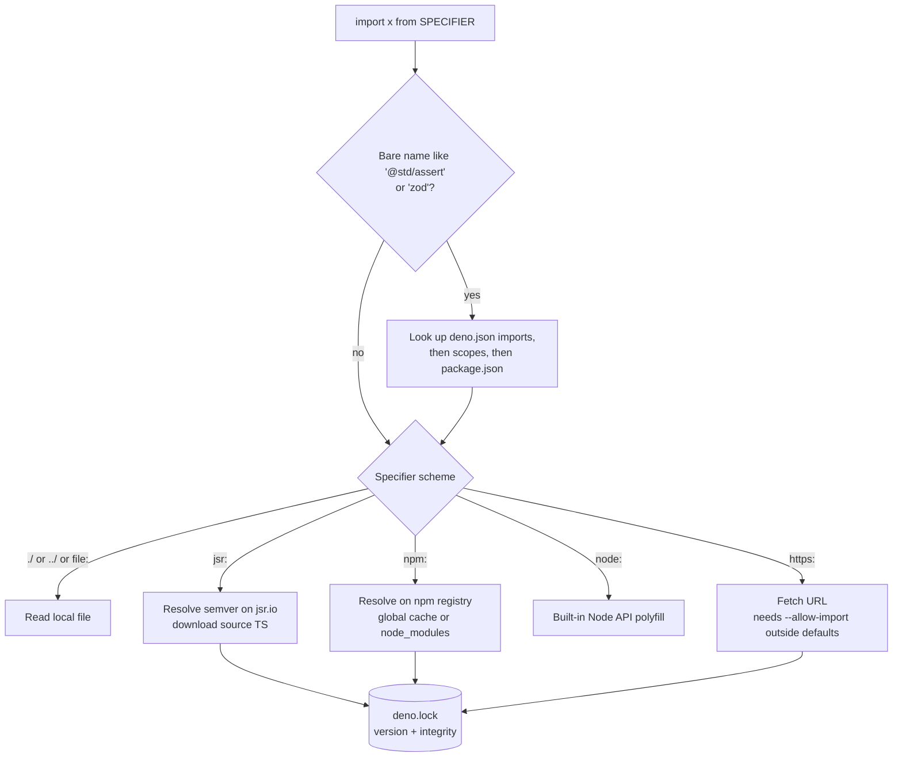

### 3.1 ES Modules and the Five Specifier Kinds

There is no `require()` in Deno-first code and no extension guessing. A specifier tells Deno exactly where code comes from:

| Specifier | Example | Resolved by | Needs a permission? |
| :--- | :--- | :--- | :--- |
| Relative or absolute file | `./store.ts`, `../src/types.ts` | The file system, relative to the importing module | No |
| JSR | `jsr:@std/path@^1.1.0/join` | jsr.io, highest version matching the range | No |
| npm | `npm:zod@^4`, `npm:@hono/node-server@1` | npm registry (or `.npmrc` registry) | No to download; the package's code may need permissions at runtime |
| Node built-in | `node:fs/promises`, `node:crypto` | Deno's Node compatibility layer | The underlying operation does (`fs` needs `--allow-read`) |
| HTTPS URL | `https://esm.sh/preact@10` | Plain HTTP fetch | `--allow-import` for hosts outside the default list ([2.2](#22-permission-flags-reference)) |

Inline specifiers work without any config:

```typescript
// inline.ts -- deno run inline.ts
import { join } from "jsr:@std/path@^1/join";
import { z } from "npm:zod@^4";

console.log(join("a", "b"), z.string().parse("x"));
```

That is fine for a script, but in a project every file would repeat the version. Move versions into `deno.json` (next section) and import by bare name. The linter enforces at least a version range on inline specifiers:

```text
$ deno lint unversioned.ts
error[no-unversioned-import]: Missing version in specifier
 --> /tmp/unversioned.ts:1:22
  |
1 | import { join } from "jsr:@std/path/join";
```

The module system is the web's. `import.meta.url` is the module's own URL, `import.meta.resolve("@std/assert")` returns the URL a specifier maps to, and dynamic `import()` loads a module on demand. The demo in [examples/stage3/modules_demo.ts](./examples/stage3/modules_demo.ts) shows all three plus a JSON import:

```typescript
import { assertEquals } from "@std/assert"; // bare: resolved by deno.json "imports"
import settings from "./settings.json" with { type: "json" }; // relative + attribute
import { parseArgs } from "node:util"; // Node built-in

assertEquals(settings.retries, 3);

const { values } = parseArgs({
  args: ["--name", "deno"],
  options: { name: { type: "string" } },
});

console.log(`${settings.appName}: hello ${values.name}`);
console.log("resolved @std/assert to", import.meta.resolve("@std/assert"));

// Dynamic import: loaded only when this line runs.
const { MemoryItemStore } = await import("../../src/store.ts");
console.log(
  "lazy-loaded store has",
  (await new MemoryItemStore().list()).length,
  "items",
);
```

```text
$ deno run examples/stage3/modules_demo.ts
modules-demo: hello deno
resolved @std/assert to https://jsr.io/@std/assert/1.0.19/mod.ts
lazy-loaded store has 0 items
```

| Line / API | Role | What happens at runtime |
| :--- | :--- | :--- |
| `from "@std/assert"` | Bare specifier | Looked up in `"imports"`; becomes `jsr:@std/assert@^1.0.0`, then the locked version. |
| `with { type: "json" }` | Import attribute | Parses the file as JSON at load time. No `--allow-read` needed: it is part of the module graph. |
| `from "node:util"` | Node built-in | Served by the compatibility layer; `parseArgs` behaves as in Node. |
| `import.meta.resolve(...)` | Resolution without loading | Returns the final URL. Useful when debugging import maps. |
| `await import("../../src/store.ts")` | Dynamic import | Fetched and evaluated on first call. Deno analyses string-literal dynamic imports ahead of time, so they are type-checked and included by `deno compile`. |

Import attributes replaced the older `assert { type: "json" }` syntax in Deno 2. Since 2.8, `with { type: "text" }` and `with { type: "bytes" }` are stable too.

### 3.2 `deno.json` Anatomy

One file configures dependencies, tasks, permissions, the compiler, the formatter, the linter and the test runner. Deno looks for `deno.json` or `deno.jsonc` in the current directory and its parents. This is the starter's [deno.json](./deno.json) in full:

```json
{
  "name": "@learninghub/learn-deno",
  "exports": "./src/main.ts",
  "tasks": {
    "start": "deno run -P src/main.ts",
    "dev": "deno run -P --watch src/main.ts",
    "test": "deno test",
    "check": "deno check",
    "lint": "deno lint",
    "fmt": "deno fmt --check",
    "compile": "deno compile -P --output dist/server src/main.ts",
    "ci": {
      "description": "Everything CI runs, in order",
      "dependencies": ["fmt", "lint", "check", "test"],
      "command": "echo all checks passed"
    }
  },
  "permissions": {
    "default": {
      "net": ["0.0.0.0", "127.0.0.1"],
      "env": ["PORT"]
    }
  },
  "compile": {
    "permissions": "default"
  },
  "imports": {
    "@std/assert": "jsr:@std/assert@^1.0.0"
  },
  "test": {
    "include": ["tests/"]
  },
  "compilerOptions": {
    "strict": true
  },
  "lint": {
    "rules": {
      "tags": ["recommended"]
    }
  },
  "fmt": {
    "include": ["src/", "tests/", "examples/", "deno.json"]
  }
}
```

| Key | Purpose | Notes |
| :--- | :--- | :--- |
| `name`, `exports` | Package identity | Required to publish to JSR or to be referenced by name inside a workspace. Add `version` when you publish. |
| `tasks` | Named commands | String form or object form with `description` and `dependencies` ([3.8](#38-tasks-scripts-with-dependencies)). |
| `permissions`, `compile` | Permission sets | Stage 2, [2.4](#24-permission-sets-in-denojson). |
| `imports` | Import map | Maps bare names to specifiers. `"@/": "./src/"` style prefix entries map whole folders. |
| `scopes` | Per-folder import map overrides | Lets `vendor/legacy/` see a different version of a package. |
| `test`, `bench` | Runner config | `include`, `exclude`, `permissions`, and sanitizer switches. |
| `compilerOptions` | TypeScript options | Only type-checking options; output options such as `target` do not apply. |
| `lint`, `fmt` | Linter and formatter config | `fmt` here is limited to code folders so `deno fmt --check` does not reflow this README. |
| `nodeModulesDir` | npm install layout | `"none"`, `"auto"` or `"manual"` ([3.4](#34-npm-packages-and-node_modules-modes)). |
| `lock` | Lockfile behaviour | `false` disables it; `{ "frozen": true }` makes every command behave like `--frozen`. |
| `workspace` | Member folders | [3.7](#37-workspaces-and-monorepos). |
| `exclude` | Global ignore list | Applies to fmt, lint, check and test. `.gitignore` is respected too. |

The earlier README showed a gateway config with `deno.json` tasks using `--allow-all` for tests and both Zod and Express in `imports`. Those still work, but the starter shows the shape this guide recommends: tests need no permissions, and runtime permissions live in a named set.

### 3.3 JSR: the TypeScript-First Registry

JSR (jsr.io) is the package registry Deno's team launched in 2024. The standard library lives there under `@std`. What makes it different from npm, rewritten from the earlier README with the inaccurate parts removed:

- **You publish TypeScript source.** No build step, no separate `.d.ts`. JSR serves the TypeScript to Deno and generates JavaScript plus declarations for npm-based clients.
- **Generated documentation and a package score.** Docs come from your JSDoc and exported types. The score rewards docs, a description, runtime-compatibility labels and the absence of "slow types".
- **Cross-runtime.** Node, Bun and Cloudflare Workers projects can install JSR packages through JSR's npm compatibility layer (`npx jsr add @std/path`, and pnpm and Yarn support `jsr:` natively).
- **Tokenless publishing from CI.** A GitHub Actions job with `id-token: write` publishes with OIDC, and the package page links to the exact workflow run that built it. No long-lived publish token to steal.
- **Immutable versions.** A published version cannot be overwritten; you can only yank it.

JSR does not check that your version numbers follow semver against the API you changed; that is still your job.

Add a JSR dependency:

```bash
deno add jsr:@std/path
```

```text
+ jsr:@std/path 1.1.6
```

and `deno.json` gains `"@std/path": "jsr:@std/path@^1.1.6"`. Packages use subpath exports, so import only what you need:

```typescript
import { join } from "@std/path/join";
import { assertEquals } from "@std/assert";

assertEquals(join("logs", "2026", "app.log"), "logs/2026/app.log");
```

The `@std` modules you will use most: `@std/assert` and `@std/testing` (Stage 6), `@std/path`, `@std/fs`, `@std/http` (Stage 4: `STATUS_CODE`, `serveDir`, cookies), `@std/streams`, `@std/encoding`, `@std/dotenv`, `@std/cli`, `@std/async` (retry, debounce, deadline), `@std/collections`. Modules with a version below 1.0 can still change in a minor release.

### 3.4 npm Packages and `node_modules` Modes

`npm:` specifiers download packages into a global cache (`DENO_DIR`) and resolve them from there, so a pure-Deno project has no `node_modules` folder at all. Some tools expect one (bundlers, frameworks with their own resolvers, packages that read files relative to `node_modules`), so Deno offers three modes:

| `nodeModulesDir` | Who creates `node_modules` | Use it when |
| :--- | :--- | :--- |
| `"none"` (default without `package.json`) | Nobody; everything comes from the global cache | New Deno projects. Fastest, nothing to clean. |
| `"auto"` | Deno, on the fly while running | A dependency needs a real `node_modules` (Vite plugins, Prisma, packages with native addons). |
| `"manual"` (default with `package.json`) | You, by running `deno install` (or npm/pnpm) | Existing Node projects you are moving to Deno. |

With a `package.json` present, Deno reads its `dependencies` and expects the folder to be populated:

```text
$ deno run main.ts
error: Could not resolve "chalk", but found it in a package.json. Deno expects the node_modules/ directory to be up to date. Did you forget to run `deno install`?

$ deno install
+ npm:chalk 5.6.2
```

npm code runs inside the same sandbox as your code. The same project then fails like this, because `chalk` sniffs CI environment variables to decide on colour support:

```text
$ deno run main.ts
error: Uncaught (in promise) NotCapable: Requires env access to "TF_BUILD", run again with the --allow-env flag
    at _supportsColor (file:///tmp/pj/node_modules/.deno/chalk@5.6.2/node_modules/chalk/source/vendor/supports-color/index.js:86:17)
```

This is the sandbox doing its job: you learn what a dependency touches. The fix is a decision, not a reflex. Either grant those variables, or use `--ignore-env` so the library sees `undefined` and falls back to its defaults.

npm lifecycle scripts (`postinstall` and friends) do not run unless you allow them, because they run outside the sandbox:

```bash
deno install --allow-scripts=npm:sharp     # allow one package
deno approve-scripts                        # choose interactively, saved to deno.json
```

### 3.5 The Lockfile, `--frozen` and Reproducible Installs

The first time Deno resolves a remote dependency it writes `deno.lock` with the exact version chosen for each range and an integrity hash of the content. Later runs reuse that version and verify the hash. A trimmed lockfile from a project with `@std/assert`, `@std/path` and `zod`:

```json
{
  "version": "5",
  "specifiers": {
    "jsr:@std/assert@1": "1.0.19",
    "jsr:@std/path@^1.1.6": "1.1.6",
    "npm:zod@^4.6.7": "4.6.7"
  },
  "jsr": {
    "@std/path@1.1.6": {
      "integrity": "c68485c2a4dfbb5ae3cc74fae4e8c4e5d874cf8a8ed12927917235c758b46cbe",
      "dependencies": ["jsr:@std/internal@^1.0.14"]
    }
  },
  "npm": {
    "zod@4.6.7": {
      "integrity": "sha512-g8W2D2kU6a8untc053fX1uVBKzM7yqAxW/3zwk83+6RyF2+SKOuV+c0wBDhUwzV1PaGapmZH+rmcUzPf+3CGwg=="
    }
  }
}
```

Commit it. Without it, two machines can resolve `^1.0.0` to different versions on different days.

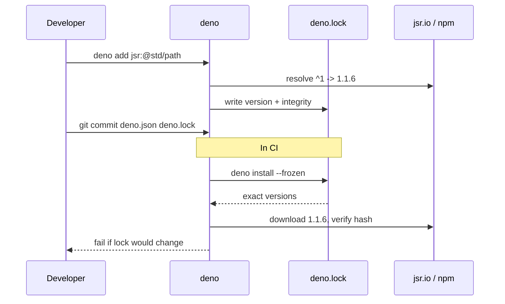

`--frozen` turns "the lockfile would change" from a silent update into an error. This is what you see when someone adds an import without updating the lock:

```text
$ deno check --frozen x.ts
error: The lockfile is out of date. Run `deno install --frozen=false`, or rerun with `--frozen=false` to update it.
changes:
14 | +    "@std/fmt@1.0.10": {
15 | +      "integrity": "90dfba288802ac6de82fb31d0917eb9e4450b9925b954d5e51fc29ac07419db5"
16 | +    },
```

| Command | Behaviour | Where to use it |
| :--- | :--- | :--- |
| `deno install` | Installs everything in `deno.json`/`package.json`, updates the lock if needed | Local development |
| `deno install --frozen` | Same, but fails if the lock would change | CI, Docker builds (this repo's [Dockerfile](./Dockerfile) and [ci.yml](./.github/workflows/ci.yml)) |
| `deno install --entrypoint src/main.ts` | Caches only that module graph | Docker build stage: smaller cache layer. Replaces `deno cache` from Deno 1. |
| `deno ci` (2.8+) | Clean install strictly from the lockfile; `--prod` skips dev dependencies | CI for projects with a `package.json` |
| `"lock": { "frozen": true }` | Makes `--frozen` the default for every command | Teams that want lock changes to be deliberate |

Since 2.9, `deno install` can seed `deno.lock` from an existing `package-lock.json`, `pnpm-lock.yaml`, `yarn.lock` or `bun.lock`, so migrating a Node project keeps the versions you already tested. It can also resolve Git merge conflicts inside `deno.lock` on its own.

### 3.6 Managing Dependencies: add, remove, outdated, update, why, list

| Task | Command | Result |
| :--- | :--- | :--- |
| Add a runtime dependency | `deno add jsr:@std/path npm:zod` | Entries in `imports` (or `package.json` if it exists), lock updated |
| Add a dev dependency | `deno add -D npm:@types/express` | Goes to `devDependencies` when a `package.json` exists |
| Pin an exact version | `deno add --exact npm:zod@4.6.7` | `"npm:zod@4.6.7"` with no caret |
| Remove | `deno remove zod` | Entry and lock data removed |
| See what is out of date | `deno outdated` (`-r` for workspaces) | Table of current version, newest update within the range, and latest |
| Update within ranges | `deno update` or `deno outdated --update` | Lock moves forward, ranges unchanged |
| Update past the range | `deno update --latest` | Rewrites the range, may be a breaking upgrade |
| Pick interactively | `deno update -i` | Checkbox list |
| Why is this installed? | `deno why zod` | Chain of dependents |
| List declared dependencies | `deno list` | Package, required range, resolved version |
| Run a CLI from a package | `deno x npm:cowsay hello` or `dx` | Like `npx`, without adding the package |
| Install a CLI globally | `deno install -g -N jsr:@std/http/file-server` | A launcher script in `~/.deno/bin`, with the permissions you passed |

Real output from `deno list` on the starter:

```text
┌─────────────────┬──────────┬──────────┐
│ Package         │ Required │ Resolved │
├─────────────────┼──────────┼──────────┤
│ jsr:@std/assert │ ^1.0.0   │ 1.0.19   │
└─────────────────┴──────────┴──────────┘
```

For supply-chain hygiene, combine `"minimumDependencyAge"` in `deno.json` (refuse versions published too recently) with `deno audit` in CI (known advisories).

### 3.7 Workspaces and Monorepos

A workspace is a root `deno.json` with a `"workspace"` list. Each member has its own `deno.json` with a `name`, and members import each other by that name with no publishing step and no relative paths across packages.

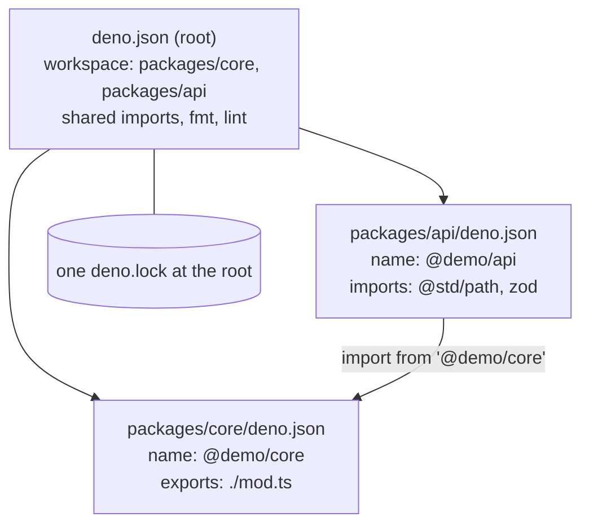

```json
// deno.json (root)
{
  "workspace": ["./packages/core", "./packages/api"],
  "imports": { "@std/assert": "jsr:@std/assert@^1.0.0" }
}
```

```json
// packages/core/deno.json
{ "name": "@demo/core", "version": "0.1.0", "exports": "./mod.ts", "license": "MIT" }
```

```typescript
// packages/core/mod.ts
/** Lowercases a string and joins words with hyphens. */
export function slugify(input: string): string {
  return input.toLowerCase().trim()
    .replace(/[^a-z0-9]+/g, "-")
    .replace(/^-|-$/g, "");
}
```

```typescript
// packages/api/main.ts
import { slugify } from "@demo/core";

console.log(slugify("Hello Deno Workspaces!")); // hello-deno-workspaces
```

Rules worth knowing:

| Rule | Consequence |
| :--- | :--- |
| One lockfile, at the root | All members agree on dependency versions. |
| Root `imports` are visible to every member; member `imports` only to that member | Put shared dependencies at the root. `deno add` run inside a member writes to that member's `deno.json`. |
| `fmt`, `lint` and `compilerOptions` cascade from root to members | A member can override `lint.rules` but not opt out of the workspace's lockfile. |
| `deno task --recursive` / `--filter "@demo/*"` | Runs a task in every matching member. |
| `deno publish` at the root | Publishes every member with a `name` and `version`, in dependency order. |
| Node workspaces (`package.json` with `"workspaces"`) are understood too | A mixed repo can migrate one package at a time. |

### 3.8 Tasks: Scripts with Dependencies

`deno task` runs commands from `"tasks"` with a built-in cross-platform shell, so `&&`, `|`, `>`, environment assignments and globs work the same on Windows. The object form adds a description and dependencies that run first (in parallel when they do not depend on each other):

```text
$ deno task
Available tasks:
- start
    deno run -P src/main.ts
- dev
    deno run -P --watch src/main.ts
- test
    deno test
- check
    deno check
- lint
    deno lint
- fmt
    deno fmt --check
- compile
    deno compile -P --output dist/server src/main.ts
- ci
    // Everything CI runs, in order
    echo all checks passed
    depends on: fmt, lint, check, test
```

`deno task ci` runs `fmt`, `lint`, `check` and `test`, then the command. Other features:

| Feature | Example | Since |
| :--- | :--- | :--- |
| Run a task through `deno run` | `deno run start` when no file named `start` exists | 2.x |
| Wildcards | `deno task "build-*"` | 2.2 |
| Ad-hoc command with the task shell | `deno task --eval "echo $HOME && ls"` | 2.1 |
| Skip missing tasks | `deno task --if-present lint` | 2.9 |
| Limit parallelism | `deno task --jobs 2 ci` | 2.9 |
| npm scripts | Tasks fall back to `package.json` `scripts` | 2.0 |

Task commands run with the permissions written in them. A task is a shell command line, not a sandboxed call, so review task changes in pull requests the way you review CI changes.

### 3.9 Publishing a Package to JSR

A JSR package is a folder whose `deno.json` (or `jsr.json`) has `name`, `version` and `exports`. Run `deno publish --dry-run` first: it type-checks, looks for slow types and lists the files it would upload.

```text
$ deno publish --dry-run
Check mod.ts
Checking for slow types in the public API...
error[missing-explicit-return-type]: missing explicit return type in the public API
 --> /tmp/ws/packages/core/mod.ts:1:17
  |
1 | export function slugify(input: string) {
  |                 ^^^^^^^ this function is missing an explicit return type
  = hint: add an explicit return type to the function

error[missing-license]: missing license field or file
 --> /tmp/ws/packages/core/deno.json
  = hint: add a "license" field. Alternatively, add a LICENSE file to the package
```

**Slow types** are exported types that JSR cannot read without running the full type checker, most often a missing return type. JSR rejects them by default because explicit types let it generate `.d.ts` files and docs quickly, and keep consumers' type-checking fast. The `@demo/core` code in [3.7](#37-workspaces-and-monorepos) already has `: string` and `"license": "MIT"`, so it passes.

Publish from GitHub Actions without a token:

```yaml
# .github/workflows/publish.yml
name: Publish
on:
  push:
    tags: ["v*"]
jobs:
  publish:
    runs-on: ubuntu-latest
    permissions:
      contents: read
      id-token: write # lets JSR verify this workflow with OIDC
    steps:
      - uses: actions/checkout@v5
      - uses: denoland/setup-deno@v2
        with:
          deno-version: v2.x
      - run: deno publish
```

Link the GitHub repository to the package in the JSR settings once; after that, only workflows from that repo can publish it. Use `deno bump-version` (2.8+) to raise `version` in `deno.json` before tagging, and `"publish": { "exclude": ["tests/", "examples/"] }` to keep the upload small.

### 3.10 Pitfalls

| Pitfall | Symptom | Fix |
| --- | --- | --- |
| Bare import with no mapping | `error: Import "zod" not a dependency` with `hint: If you want to use the npm package, try running deno add npm:zod` | `deno add npm:zod`, or use an inline `npm:` specifier. |
| Lockfile not committed | CI resolves a newer patch than your laptop; "works on my machine" | Commit `deno.lock` and install with `--frozen` in CI. |
| Lockfile out of date in CI | `error: The lockfile is out of date. Run deno install --frozen=false ...` | Run `deno install` locally and commit the updated lock with the import change. |
| `package.json` present but no `node_modules` | `error: Could not resolve "chalk", but found it in a package.json ... Did you forget to run deno install?` | `deno install`, or set `"nodeModulesDir": "none"` if you only use `npm:` specifiers. |
| npm package needs unexpected permissions | `NotCapable: Requires env access to "TF_BUILD"` from inside `node_modules/.deno/...` | Decide: grant the variables, or `--ignore-env` so the package sees `undefined`. |
| HTTPS import from an unlisted host | `error: Requires import access to "example.com:443", run again with the --allow-import flag` | Prefer a JSR or npm package; otherwise add `--allow-import=example.com`. |
| Publishing with inferred return types | `error[missing-explicit-return-type]` during `deno publish` | Add explicit types to every exported function, class member and constant. |
| `deno fmt` reformatting docs or generated files | Huge unrelated diffs in Markdown | Limit `fmt.include` or add paths to `fmt.exclude`, as the starter does. |
| Using `assert { type: "json" }` from old tutorials | Deprecation warning, then a syntax error | Use `with { type: "json" }`. |

### 3.11 Best Practices

- **Keep versions in `deno.json` `imports`, not in import statements:** one place to upgrade, and the linter's `no-unversioned-import` covers the rest.
- **Commit `deno.lock` and use `--frozen` in CI and Docker:** builds stay reproducible and lockfile drift fails loudly.
- **Prefer JSR for TypeScript-first libraries and `@std`:** source is TypeScript, docs are generated, and there is no `@types` package to keep in sync.
- **Use `"nodeModulesDir": "none"` until a tool forces otherwise:** fewer files, faster installs, nothing to `.gitignore`.
- **Leave npm lifecycle scripts off by default:** approve the few packages that need them with `deno approve-scripts`.
- **Give every exported function an explicit return type:** it is required for JSR and makes API changes visible in review.
- **Use workspaces instead of relative imports across packages:** members import each other by name, and the boundary is clear.
- **Put the CI command list in a `ci` task:** developers run the same checks locally with `deno task ci`.

### 3.12 Hands-on Exercise

Split the starter's validation into its own workspace member.

1. Add `"workspace": ["./packages/validation"]` to the root `deno.json` and keep the app at the root; the root can be both the workspace root and a package.
2. Move `src/validation.ts` and the parts of `src/types.ts` it needs into `packages/validation/mod.ts`. Give the member `"name": "@learn-deno/validation"`, `"version": "0.1.0"`, `"exports": "./mod.ts"` and `"license": "MIT"`.
3. Change `src/server.ts` to `import { parseNewItem } from "@learn-deno/validation";`.
4. Run `deno check`, `deno test` and `deno publish --dry-run --allow-dirty` from `packages/validation`.

Expected output:

```text
$ deno test
ok | 14 passed (13 steps) | 0 failed
$ cd packages/validation && deno publish --dry-run --allow-dirty
Check mod.ts
Checking for slow types in the public API...
Simulating publish of @learn-deno/validation@0.1.0 with files:
   file:///.../packages/validation/deno.json (98B)
   file:///.../packages/validation/mod.ts (1.72KB)
Success Dry run complete
```

If the dry run reports slow types, add the missing explicit types; the error points at the exact export.

[Back to top ⤴️](#-table-of-contents)

---

## 4. Stage 4: Web Standards & HTTP Servers

Deno's server APIs are the browser's `fetch` types turned around: a handler receives a `Request` and returns a `Response`. The HTTP server underneath is built on Rust's `hyper`. This stage covers `Deno.serve`, streaming, WebSockets and the Web Crypto API.

### 4.1 The `Deno.serve` HTTP Engine

One handler covers JSON, a streaming Server-Sent Events endpoint and a WebSocket upgrade. Run it with `deno run --allow-net=0.0.0.0:8000 server.ts`.

```typescript
// server.ts
import { STATUS_CODE, STATUS_TEXT } from "jsr:@std/http@^1/status";

Deno.serve({
  port: 8000,
  hostname: "0.0.0.0",
  onListen({ port, hostname }) {
    console.log(`Deno HTTP server listening on http://${hostname}:${port}`);
  },
  handler(req: Request, info: Deno.ServeHandlerInfo): Response {
    const url = new URL(req.url);

    // 1. Health check probe
    if (url.pathname === "/healthz") {
      return Response.json({
        status: "UP",
        remoteAddress: info.remoteAddr,
        timestamp: new Date().toISOString(),
      });
    }

    // 2. Streaming response using the Web Streams API (Server-Sent Events)
    if (url.pathname === "/stream") {
      const encoder = new TextEncoder();
      const bodyStream = new ReadableStream<Uint8Array>({
        async start(controller) {
          for (let i = 1; i <= 5; i++) {
            controller.enqueue(
              encoder.encode(`event: message\ndata: Payload chunk ${i}\n\n`),
            );
            await new Promise((r) => setTimeout(r, 200));
          }
          controller.close();
        },
      });

      return new Response(bodyStream, {
        headers: {
          "Content-Type": "text/event-stream",
          "Cache-Control": "no-cache",
        },
      });
    }

    // 3. WebSocket upgrade
    if (url.pathname === "/ws") {
      if (req.headers.get("upgrade") !== "websocket") {
        return new Response("Expected WebSocket upgrade", {
          status: STATUS_CODE.BadRequest,
        });
      }
      const { socket, response } = Deno.upgradeWebSocket(req);

      socket.onopen = () => console.log("WebSocket client connected.");
      socket.onmessage = (event) => {
        socket.send(`Echo from Deno: ${event.data}`);
      };
      socket.onclose = () => console.log("WebSocket client disconnected.");

      return response;
    }

    return new Response(STATUS_TEXT[STATUS_CODE.NotFound], {
      status: STATUS_CODE.NotFound,
    });
  },
});
```

Changes from the earlier version of this example: `@std/http` 1.x exports `STATUS_CODE` (the old `Status` enum is gone), and the `Connection: keep-alive` header was removed because it is invalid on HTTP/2 connections and `Deno.serve` manages keep-alive itself. Since Deno 2.9, responses are not compressed unless you pass `automaticCompression: true`.

### 4.2 Zero-Dependency AES-GCM Envelope Encryption

Deno implements the W3C Web Cryptography API natively, so authenticated encryption needs no library:

```typescript
// crypto-vault.ts
export async function generateMasterKey(): Promise<CryptoKey> {
  return await crypto.subtle.generateKey(
    { name: "AES-GCM", length: 256 },
    true,
    ["encrypt", "decrypt"],
  );
}

export async function encryptPayload(
  data: string,
  key: CryptoKey,
): Promise<{ cipherHex: string; ivHex: string }> {
  const iv = crypto.getRandomValues(new Uint8Array(12)); // 96-bit IV for AES-GCM
  const encoded = new TextEncoder().encode(data);

  const ciphertext = await crypto.subtle.encrypt(
    { name: "AES-GCM", iv },
    key,
    encoded,
  );

  const toHex = (bytes: Uint8Array) =>
    Array.from(bytes).map((b) => b.toString(16).padStart(2, "0")).join("");

  return { cipherHex: toHex(new Uint8Array(ciphertext)), ivHex: toHex(iv) };
}

export async function decryptPayload(
  cipherHex: string,
  ivHex: string,
  key: CryptoKey,
): Promise<string> {
  const fromHex = (hex: string) =>
    new Uint8Array(hex.match(/.{1,2}/g)!.map((b) => parseInt(b, 16)));

  const decrypted = await crypto.subtle.decrypt(
    { name: "AES-GCM", iv: fromHex(ivHex) },
    key,
    fromHex(cipherHex),
  );

  return new TextDecoder().decode(decrypted);
}
```

Never reuse an IV with the same key: AES-GCM loses both confidentiality and integrity if you do. A random 96-bit IV per message is the safe default.

### 4.3 Stream Pipelines with Backpressure

`pipeThrough` connects transform stages. Each stage pulls from the previous one only as fast as the next one consumes, which is backpressure without any manual bookkeeping:

```typescript
// transform-stream.ts
const uppercase = new TransformStream<string, string>({
  transform(chunk, controller) {
    controller.enqueue(chunk.toUpperCase());
  },
});

const source = new ReadableStream<string>({
  start(controller) {
    controller.enqueue("event-a\n");
    controller.enqueue("event-b\n");
    controller.close();
  },
});

const piped = source
  .pipeThrough(uppercase)
  .pipeThrough(new TextEncoderStream());

// Consume: write the bytes to stdout.
await piped.pipeTo(Deno.stdout.writable, { preventClose: true });
```

### 4.4 Pitfalls

| Pitfall | Symptom | Fix |
| --- | --- | --- |
| Blocking the event loop with heavy synchronous work | Every request stalls while one computes | Offload CPU-bound work to a `Worker`, or compile the hot path to WebAssembly. |
| Setting hop-by-hop headers such as `Connection` | Errors or ignored headers on HTTP/2 | Let `Deno.serve` manage connection headers. |
| Expecting compressed responses after upgrading to 2.9 | Larger payloads | Pass `automaticCompression: true` or compress at the proxy. |

### 4.5 Best Practices

- **Write handlers as `(Request) => Response` functions:** they test without a socket, as the starter's tests show.
- **Stream large bodies with `ReadableStream`:** memory stays flat regardless of payload size.
- **Use Web Crypto before reaching for a crypto package:** it is native, audited and available in every Deno deployment target.

[Back to top ⤴️](#-table-of-contents)

---

## 5. Stage 5: Persistence & Background Work: Deno KV, Queues & Cron

Deno KV is an ordered, transactional key-value database built into the runtime. Locally it is backed by SQLite; on Deno Deploy it is a managed, replicated service backed by FoundationDB. Queues and cron build on the same machinery. All three are still behind unstable flags in Deno 2.9: `--unstable-kv` and `--unstable-cron` (without them, `Deno.openKv` and `Deno.cron` are `undefined`).

### 5.1 Hierarchical Keys & Atomic Mutations

```typescript
// kv-store.ts -- deno run --unstable-kv kv-store.ts
const kv = await Deno.openKv();

// Keys are arrays of primitives: [namespace, partitionKey, entityId]
const userKey = ["users", "org_123", "user_abc"];
const emailIndexKey = ["users_by_email", "admin@company.com"];

interface UserProfile {
  id: string;
  email: string;
  role: string;
  loginCount: number;
}

const newUser: UserProfile = {
  id: "user_abc",
  email: "admin@company.com",
  role: "admin",
  loginCount: 1,
};

// 1. Atomic transaction: create the user only if neither key exists yet
const atomicTx = await kv.atomic()
  .check({ key: userKey, versionstamp: null }) // key must not exist
  .check({ key: emailIndexKey, versionstamp: null })
  .set(userKey, newUser)
  .set(emailIndexKey, newUser.id)
  .commit();

if (atomicTx.ok) {
  console.log("User created with an atomic secondary index");
} else {
  console.error("Atomic transaction failed: user or email already registered");
}

// 2. Strongly consistent read
const result = await kv.get<UserProfile>(userKey);
console.log("Retrieved value:", result.value);
console.log("Versionstamp:", result.versionstamp);

// 3. Prefix range query
const entries = kv.list<UserProfile>({ prefix: ["users", "org_123"] });
for await (const entry of entries) {
  console.log(`Found ${entry.key.join("/")} -> ${entry.value.email}`);
}
```

`check({ key, versionstamp: null })` is optimistic concurrency control: the commit fails if anyone changed the key since you read it (or, with `null`, if it exists at all). Always check before overwriting keys that other requests can also write.

### 5.2 Scheduled Jobs with `Deno.cron`

```typescript
// cron-jobs.ts -- deno run --unstable-cron --unstable-kv cron-jobs.ts
Deno.cron("Hourly token audit", "0 * * * *", async () => {
  console.log("Executing scheduled hourly token audit...");
  const kv = await Deno.openKv();
  // Reconcile active sessions here
  kv.close();
});

Deno.cron("Daily backup", "0 0 * * *", () => {
  console.log("Starting daily export");
});
```

Cron handlers must be registered at the top level of the module, at startup. A run that is still executing when the next one is due is skipped rather than overlapped.

### 5.3 Background Queues with `kv.enqueue`

```typescript
// worker-queue.ts -- deno run --unstable-kv worker-queue.ts
const kv = await Deno.openKv();

interface EmailNotificationJob {
  to: string;
  subject: string;
  body: string;
}

function isEmailJob(value: unknown): value is EmailNotificationJob {
  return typeof value === "object" && value !== null && "to" in value;
}

// 1. Listen for jobs. A thrown exception makes Deno redeliver the message.
kv.listenQueue((message: unknown) => {
  if (!isEmailJob(message)) return;
  console.log(`Processing email job for ${message.to}`);
});

// 2. Enqueue a job with a delivery delay
await kv.enqueue(
  {
    to: "client@example.com",
    subject: "Monthly report",
    body: "Your statement is attached.",
  } satisfies EmailNotificationJob,
  { delay: 5000 }, // deliver after 5 seconds
);
console.log("Job dispatched to the queue");
```

Delivery is at least once, so handlers must be idempotent: a retry after a crash can deliver the same message twice.

### 5.4 Pitfalls

| Pitfall | Symptom | Fix |
| --- | --- | --- |
| Running KV code without the flag | `TypeError: Deno.openKv is not a function` | Add `--unstable-kv`, or `"unstable": ["kv"]` in `deno.json`. |
| Overwriting keys without optimistic concurrency | Lost updates under concurrent writes | Use `kv.atomic().check(entry)` before `set`. |
| Non-idempotent queue handlers | Duplicate emails or charges after a retry | Record processed message ids in KV inside the same atomic operation. |

### 5.5 Best Practices

- **Design keys as paths from general to specific:** prefix queries then become cheap range scans.
- **Maintain secondary indexes in the same atomic transaction as the primary record:** they can never disagree.
- **Treat every queue message as possibly duplicated:** at-least-once delivery is the contract.

[Back to top ⤴️](#-table-of-contents)

---

## 6. Stage 6: Testing, Tooling & Production Deployment

Deno ships the test runner, benchmark runner and single-binary compiler, so the path from a passing test to a production container uses no third-party tooling. This repo's CI and Dockerfile are the worked example.

### 6.1 The Integrated Test Runner

```typescript
// api_test.ts -- needs the server from Stage 4 running on port 8000
import { assertEquals } from "jsr:@std/assert@^1";

Deno.test({
  name: "unknown route returns 404",
  permissions: { net: ["127.0.0.1:8000"] },
  async fn() {
    const res = await fetch("http://127.0.0.1:8000/nope");
    await res.body?.cancel();
    assertEquals(res.status, 404);
  },
});
```

The starter's own tests in [tests/](./tests/) avoid the network altogether by calling the handler directly, which is faster and needs no permissions.

### 6.2 Sanitizers, Leaks and Why They Are Opt-in Now

`Deno.test` has three sanitizers. The **exit sanitizer** fails a test that calls `Deno.exit()` and is on by default. The **ops sanitizer** fails a test that leaves async operations (timers, pending reads) running when it ends, and the **resources sanitizer** fails one that leaves files, sockets or child processes open. Since Deno 2.8 the ops and resources sanitizers are off by default, because they produced false positives for code using Node-style timers and npm packages.

Turn them back on when you want leak detection:

```bash
deno test --sanitize-ops --sanitize-resources
```

```json
{ "test": { "sanitizeOps": true, "sanitizeResources": true } }
```

```typescript
Deno.test("timer is cleaned up", () => {
  const timer = setTimeout(() => {}, 100);
  // With --sanitize-ops, removing this line fails the test with a leak report.
  clearTimeout(timer);
});
```

### 6.3 Micro-Benchmarks with `deno bench`

```typescript
// crypto_bench.ts -- deno bench crypto_bench.ts
Deno.bench("SHA-256 digest", async () => {
  const data = new TextEncoder().encode("telemetry benchmark payload");
  await crypto.subtle.digest("SHA-256", data);
});

Deno.bench("base64 encode", () => {
  btoa("sample-session-id-123456789");
});
```

### 6.4 Compiling to a Standalone Executable

```bash
# Compile a TypeScript app into a self-contained binary (no Deno needed on the target)
deno compile --allow-net --allow-env --output service src/main.ts
./service

# Cross-compile for another platform
deno compile --target aarch64-unknown-linux-gnu --output service-arm64 src/main.ts
```

The starter uses `deno task compile`, which passes `-P` so the binary carries exactly the `default` permission set.

### 6.5 Multi-Stage Docker Image

The repo's [Dockerfile](./Dockerfile) compiles the starter in a full `denoland/deno` image, then copies only the binary into `gcr.io/distroless/cc-debian12:nonroot`: no shell, no package manager, a non-root user, and a self-check for `HEALTHCHECK`.

```dockerfile
# syntax=docker/dockerfile:1
ARG DENO_VERSION=2.9.8

FROM denoland/deno:${DENO_VERSION} AS build
WORKDIR /app
COPY deno.json deno.lock ./
COPY src/ ./src/
RUN deno install --frozen --entrypoint src/main.ts
RUN deno compile --frozen -P --output /out/server src/main.ts

FROM gcr.io/distroless/cc-debian12:nonroot AS runtime
WORKDIR /app
COPY --from=build /out/server /app/server
ENV PORT=8000
USER nonroot
EXPOSE 8000
HEALTHCHECK --interval=30s --timeout=3s --start-period=5s \
  CMD ["/app/server", "healthcheck"]
ENTRYPOINT ["/app/server"]
```

Corrections to the earlier version of this Dockerfile: `deno cache` was replaced by `deno install --entrypoint` in Deno 2, the 2.0.0 base image is long out of date, and the runtime stage now runs as a non-root user with the permission set baked in rather than passed as flags.

### 6.6 Pitfalls

| Pitfall | Symptom | Fix |
| --- | --- | --- |
| Disabling sanitizers per test to silence failures | Leaked sockets and timers reach production | Fix the leak; close resources in `finally` or with `using`. |
| `-A` in the container `CMD` | Every dependency has full access in production | Compile with `-P` or list flags explicitly. |
| Running as root in the container | A compromise gets root inside the container | `USER nonroot` (distroless) or `USER deno` (official images). |

### 6.7 Best Practices

- **Keep CI and the Dockerfile on the same Deno version:** this repo pins `DENO_VERSION` and uses `v2.x` in CI.
- **Install with `--frozen` in every automated build:** a lockfile change must be a reviewed commit.
- **Prefer a compiled binary on distroless for services:** smaller attack surface and permissions fixed at build time.

[Back to top ⤴️](#-table-of-contents)

---

## M1. Masterclass: Node.js Compatibility & Migration

Deno 2 runs most npm packages and Node.js built-ins, which makes incremental migration possible.

### M1.1 Running Express and Node Built-ins in Deno

```typescript
// express-in-deno.ts -- deno run --allow-net --allow-env --allow-read express-in-deno.ts
// @ts-types="npm:@types/express@^5"
import express from "npm:express@^5";
import { createHash } from "node:crypto";

const app = express();
app.use(express.json());

app.get("/api/v1/hash", (req, res) => {
  const input = typeof req.query.input === "string" ? req.query.input : "";
  const hash = createHash("sha256").update(input).digest("hex");
  res.json({ algorithm: "sha256", result: hash });
});

app.listen(3000, () => {
  console.log("Express running inside Deno on port 3000");
});
```

Express reads environment variables such as `NODE_ENV` and files from its own package directory, so it needs `--allow-env` and `--allow-read` in addition to `--allow-net`.

### M1.2 Key Migration Differences from Node.js

- **Import specifiers:** replace `require("fs")` with `import fs from "node:fs"`. Deno supports `require` in `.cjs` files and inside npm packages.
- **Environment access:** `Deno.env.get("VAR")` is the native API; `process.env.VAR` also works, because `process` is a global in Deno 2.
- **Buffers:** prefer `Uint8Array` in new code. `Buffer` is a global since 2.4 for compatibility.
- **Globals:** Deno 2 removed `window`. Use `globalThis`, and `self` inside workers.
- **Permissions:** Node code assumes full access. Expect `NotCapable` errors from dependencies and grant what they name.

[Back to top ⤴️](#-table-of-contents)

---

## M2. Masterclass: FFI & WebAssembly

Deno's Foreign Function Interface calls functions in native shared libraries written in C, Rust, Zig or C++. It is still marked unstable and requires `--allow-ffi`, which gives the library full access to the process.

### M2.1 Native FFI Integration with Type Safety

```typescript
// ffi-rust.ts -- deno run --allow-ffi=. ffi-rust.ts
// Load a shared library: .so on Linux, .dylib on macOS, .dll on Windows
const libSuffix = Deno.build.os === "windows"
  ? "dll"
  : Deno.build.os === "darwin"
  ? "dylib"
  : "so";
const libraryPath = `./librust_crypto.${libSuffix}`;

const dylib = Deno.dlopen(libraryPath, {
  add_integers: {
    parameters: ["i32", "i32"],
    result: "i32",
  },
  fast_hash: {
    parameters: ["buffer", "usize"],
    result: "u64",
  },
});

const sum = dylib.symbols.add_integers(25, 17);
console.log(`Native calculation result: ${sum}`); // 42

const testData = new TextEncoder().encode("Cryptographic message signature");
const hashVal = dylib.symbols.fast_hash(testData, BigInt(testData.byteLength));
console.log(`Native 64-bit hash: ${hashVal}`);

dylib.close();
```

`u64`, `i64` and `usize` values cross the boundary as `bigint` (or `number | bigint`), so `usize` parameters take a `bigint`. Pointers are `Deno.PointerValue`, an opaque object or `null`.

[Back to top ⤴️](#-table-of-contents)

---

## M3. Masterclass: Multi-Tenant Isolation with V8 Isolates

Platforms that run customer code, such as Deno Subhosting, execute each tenant's code in its own V8 isolate with no file system or network access unless granted, and with CPU-time and memory budgets per request.

### M3.1 The Isolation Model

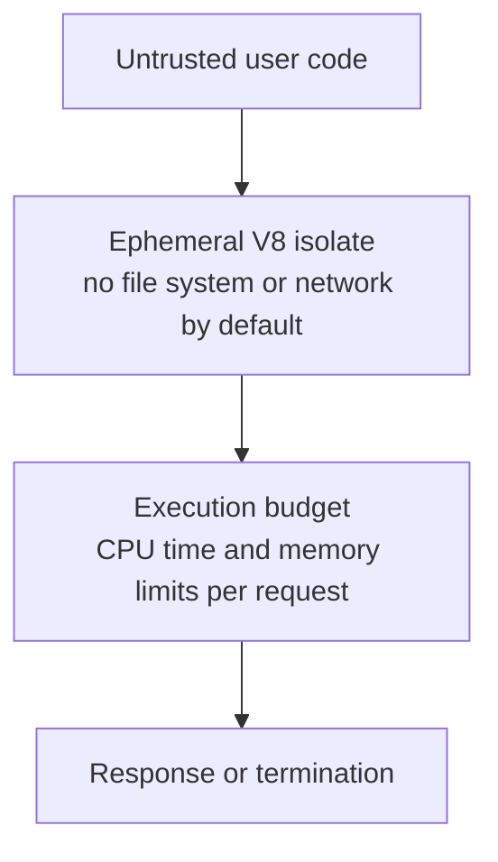

An isolate is much cheaper to start than a container or VM, which is what makes per-request isolation affordable. It is also a weaker boundary than a VM: a V8 bug can break it. Hosting platforms therefore layer process sandboxing and OS-level isolation underneath.

[Back to top ⤴️](#-table-of-contents)

---

## M4. Masterclass: Flagship Edge API Gateway with Deno KV & Rate Limiting

A gateway with a Deno KV token-bucket rate limiter, HMAC token verification and queue-based metrics. Run it with `deno run --unstable-kv --allow-net=0.0.0.0:8080 --allow-env=GATEWAY_SECRET,DENO_REGION gateway.ts`.

### M4.1 Gateway Implementation

```typescript
// gateway.ts
import { STATUS_CODE, STATUS_TEXT } from "jsr:@std/http@^1/status";

const kv = await Deno.openKv();
const API_SECRET = Deno.env.get("GATEWAY_SECRET");
if (!API_SECRET) throw new Error("GATEWAY_SECRET must be set");

interface RateLimitBucket {
  tokens: number;
  lastRefillMs: number;
}

interface ApiMetric {
  event: "API_DISPATCH";
  clientIp: string;
  endpoint: string;
  timestamp: number;
}

// 1. Atomic token-bucket rate limiter on Deno KV
async function enforceRateLimit(
  clientId: string,
  maxTokens = 60,
  refillIntervalMs = 60_000,
): Promise<boolean> {
  const key = ["rate_limits", clientId];

  while (true) {
    const now = Date.now();
    const entry = await kv.get<RateLimitBucket>(key);
    const bucket = entry.value ?? { tokens: maxTokens, lastRefillMs: now };

    const elapsed = now - bucket.lastRefillMs;
    const refills = Math.floor(elapsed / refillIntervalMs);
    const tokens = Math.min(maxTokens, bucket.tokens + refills * maxTokens);
    if (tokens <= 0) return false;

    const updated: RateLimitBucket = {
      tokens: tokens - 1,
      lastRefillMs: refills > 0 ? now : bucket.lastRefillMs,
    };
    const commit = await kv.atomic()
      .check(entry) // retry if another request changed the bucket
      .set(key, updated, { expireIn: refillIntervalMs * 2 })
      .commit();
    if (commit.ok) return true;
  }
}

// 2. HMAC token verification with Web Crypto
async function verifyHmacToken(authHeader: string | null): Promise<boolean> {
  if (!authHeader?.startsWith("Bearer ")) return false;
  const [payload, signatureHex] = authHeader.slice(7).split(".");
  if (!payload || !signatureHex) return false;

  const encoder = new TextEncoder();
  const key = await crypto.subtle.importKey(
    "raw",
    encoder.encode(API_SECRET),
    { name: "HMAC", hash: "SHA-256" },
    false,
    ["verify"],
  );
  const sigBytes = new Uint8Array(
    signatureHex.match(/.{1,2}/g)?.map((byte) => parseInt(byte, 16)) ?? [],
  );
  // crypto.subtle.verify compares in constant time
  return await crypto.subtle.verify(
    "HMAC",
    key,
    sigBytes,
    encoder.encode(payload),
  );
}

// 3. Gateway handler
Deno.serve({
  port: 8080,
  hostname: "0.0.0.0",
  async handler(req, info): Promise<Response> {
    const url = new URL(req.url);
    const clientIp = info.remoteAddr.hostname;

    if (url.pathname === "/healthz") {
      return Response.json({ status: "HEALTHY", uptimeMs: performance.now() });
    }

    if (!(await enforceRateLimit(clientIp))) {
      return new Response("Too Many Requests", {
        status: STATUS_CODE.TooManyRequests,
        headers: { "Retry-After": "60" },
      });
    }

    if (url.pathname.startsWith("/api/v1/protected")) {
      if (!(await verifyHmacToken(req.headers.get("authorization")))) {
        return new Response("Unauthorized", {
          status: STATUS_CODE.Unauthorized,
        });
      }

      await kv.enqueue({
        event: "API_DISPATCH",
        clientIp,
        endpoint: url.pathname,
        timestamp: Date.now(),
      } satisfies ApiMetric);

      return Response.json({
        message: "Access granted",
        clientIp,
        region: Deno.env.get("DENO_REGION") ?? "local",
      });
    }

    return new Response(STATUS_TEXT[STATUS_CODE.NotFound], {
      status: STATUS_CODE.NotFound,
    });
  },
});

// 4. Background metrics consumer
kv.listenQueue((job: unknown) => {
  const metric = job as ApiMetric;
  console.log(
    `[metrics] ${metric.event} from ${metric.clientIp} on ${metric.endpoint}`,
  );
});
```

Fixes compared with the earlier version: the secret no longer falls back to a hard-coded default, the status constants come from `STATUS_CODE`, the clock is read inside the retry loop, and the queue consumer is typed instead of using `any`.

[Back to top ⤴️](#-table-of-contents)

---

## 7. Stage 7: Staff Deno Engineer Interview Handbook & Cheatsheet

### 7.1 Core Concepts (Q1-Q10)

#### Q1. How do V8 isolates differ from operating system processes, and why do they suit edge platforms?

An OS process has its own virtual memory, thread stacks, file descriptor table and kernel scheduling state. Starting one and loading a JavaScript runtime into it costs tens of megabytes and noticeable time.

A V8 isolate is an independent instance of the JavaScript engine inside an existing process, with its own heap, garbage collector and microtask queue. A fresh isolate needs a few megabytes and starts in milliseconds, and objects cannot be shared between isolates. That density lets one host process run many tenants' scripts at once while keeping their heaps separate, which is why edge platforms use isolates instead of a container per request. The trade-off is a weaker boundary than a VM, so platforms add OS-level sandboxing beneath the isolates.

#### Q2. What is the internal architecture of Deno KV, and how does it provide atomic transactions?

Deno KV has pluggable backends. Locally it uses SQLite, storing keys in lexicographic order of their encoded form. On Deno Deploy it is a managed service built on FoundationDB, a distributed, ordered, transactional key-value store.

Atomicity comes from optimistic concurrency control. Every entry carries a `versionstamp` that changes on each write. `kv.atomic().check({ key, versionstamp }).set(...).commit()` succeeds only if every checked key still has the versionstamp you read; otherwise it returns `{ ok: false }` and you retry. All mutations in one atomic operation apply together or not at all, which is how secondary indexes stay consistent with their primary records.

#### Q3. How does Deno's permission sandbox enforce security at the system call boundary?

JavaScript running in V8 cannot make system calls. Every operation that touches the OS goes through a Rust op in `deno_core` or one of Deno's extensions (`op_read_file`, `op_net_connect` and so on).

Before an op performs the system call, it asks the permission container whether the descriptor (a path, host and port, variable name or program) is covered by the grants, deny lists and ignore lists. If it is not and no prompt is possible, the op returns an error that surfaces in JavaScript as `Deno.errors.NotCapable`, without ever calling the kernel. Because the only way out of V8 is through ops, a library cannot bypass the check by patching globals. The exceptions are grants that hand over native code or another process: `--allow-ffi` and `--allow-run`.

#### Q4. How does JSR differ from npm, and why was it introduced?

npm requires authors to compile TypeScript to JavaScript and ship separate declaration files, and publishing traditionally relies on long-lived tokens. JSR accepts TypeScript source and generates JavaScript and `.d.ts` files for clients that need them, so one upload serves Deno, Node, Bun and other runtimes.

JSR also generates documentation from exported types and JSDoc, scores packages on documentation and compatibility, rejects "slow types" that would make consumers' type-checking expensive, makes published versions immutable, and supports tokenless publishing from GitHub Actions through OIDC with a visible link to the build. It does not verify that version numbers follow semver; that remains the author's responsibility.

#### Q5. Why can `Deno.serve` outperform a traditional `http.createServer` setup?

`Deno.serve()` is implemented on Rust's `hyper` HTTP library and Tokio. Connection handling, HTTP parsing and much of the header work happen in Rust, and the request reaches JavaScript as a web-standard `Request` built with little copying.

Because the API is `fetch`-shaped, there is no adapter layer translating between a Node-style request object and a web `Request`, which frameworks on Node often add. Real-world throughput depends far more on what the handler does than on the server core, so benchmark your own workload rather than trusting headline numbers.

#### Q6. How does Deno avoid stalling the event loop during heavy I/O?

Network I/O is non-blocking: sockets are registered with the OS readiness API (`epoll`, `kqueue`, IOCP) through Tokio, and no thread waits on them. File system calls and DNS lookups, which block on most operating systems, run on Tokio's blocking thread pool, so the JavaScript thread keeps processing other callbacks while they complete. Promise continuations run on the V8 thread's microtask queue.

What Deno cannot fix is CPU-bound JavaScript: a long synchronous loop blocks the isolate's only thread. Move such work to a `Worker` or WebAssembly.

#### Q7. What are Deno's test sanitizers, and how did their defaults change?

`Deno.test` can check for three kinds of leaks. The resources sanitizer fails a test that leaves files, sockets or processes open. The ops sanitizer fails a test whose async operations (timers, pending reads) are still running at the end. The exit sanitizer fails a test that calls `Deno.exit()`.

Since Deno 2.8 the resources and ops sanitizers are off by default, because Node-compatible timers and npm packages caused false positives; enable them with `--sanitize-ops --sanitize-resources` or in the `test` section of `deno.json`. The exit sanitizer stays on. Teams that relied on the old defaults to catch leaked sockets should opt back in, at least in CI.

#### Q8. How does `Deno.dlopen` handle pointers and memory, and why is it gated?

Deno's FFI loads a C ABI shared library and exposes its symbols with the parameter and result types you declare. Pointers are represented as `Deno.PointerValue`, an opaque pointer object or `null`, and 64-bit integers cross the boundary as `bigint`. Buffers are passed as typed arrays whose backing store V8 does not move during the call.

Native code runs with the full rights of the process and can corrupt memory or crash it, so FFI requires `--allow-ffi`, is still marked unstable, and should be treated as a full trust grant. Prefer WebAssembly where performance allows, because Wasm stays inside V8's sandbox.

#### Q9. How does Deno 2 work with existing Node.js projects that rely on `node_modules`?

By default Deno caches npm packages globally and resolves them from that cache, so a Deno-first project has no `node_modules`. When a `package.json` exists, Deno reads its dependencies and expects a `node_modules` folder (`"nodeModulesDir": "manual"`), which `deno install`, npm or pnpm can create. With `"auto"` Deno creates and maintains it on demand.

Deno implements Node's resolution algorithm for packages, supports CommonJS `require` inside npm packages and `.cjs` files, and provides Node built-ins under `node:`. Since 2.9 `deno install` can seed `deno.lock` from an existing npm, pnpm, Yarn or Bun lockfile, so the versions you already tested carry over.

#### Q10. How does `Deno.cron` avoid duplicate executions when deployed on several nodes?

Locally, `Deno.cron` (behind `--unstable-cron`) runs in the current process, and an invocation that is still running when the next one is due is skipped. On Deno Deploy the platform reads the cron definitions at deployment time and schedules them centrally, so a schedule fires once per interval for the deployment rather than once per running instance.

The guarantee is at-least-once, not exactly-once: a retry after a failure can run a handler twice. Make cron handlers idempotent, for example by recording the scheduled time of the last completed run in Deno KV with an atomic check.

### 7.2 Internals & Performance (Q11-Q12)

#### Q11. How do edge platforms like Deno Deploy route requests and keep cold starts low?

Requests reach the nearest point of presence through anycast routing. Instead of starting a container, the platform starts or reuses a V8 isolate for the deployment, which takes milliseconds. Data in Deno KV is replicated across regions: reads can be served from a nearby replica (with `consistency: "eventual"` you opt into that explicitly), while atomic commits go through the primary region so that versionstamp checks stay correct.

#### Q12. Why does Deno use SWC to run TypeScript but `tsc` to check it?

Type stripping and transpilation are mechanical, so Deno does them with SWC, a Rust compiler that is far faster than the TypeScript compiler. That keeps `deno run` and `--watch` restarts quick, and the output is cached.

Type checking needs the real type system, so `deno check` runs the TypeScript compiler bundled in the binary (TypeScript 6.0 in Deno 2.9). `deno test`, `deno bench` and `deno compile` check by default; `deno run` does not unless you pass `--check`. The design separates fast execution from correctness checks, and CI should always run `deno check`.

### 7.5 Staff Cheatsheet

| Need | Deno answer | Gotcha |
| --- | --- | --- |
| Grant the least access | `-P` with a `deno.json` permission set | Experimental warning; anything that can write `deno.json` can widen it. |
| Detect a sandbox block | `err instanceof Deno.errors.NotCapable` | `PermissionDenied` now means an OS-level refusal. |
| Find what a dependency touches | `DENO_AUDIT_PERMISSIONS=./audit.jsonl deno test` | Audit a realistic workload, not only unit tests. |
| Reproducible installs | `deno install --frozen` with a committed `deno.lock` | `deno ci` for projects with `package.json`. |
| Type safety in CI | `deno check` | `deno run` never checks unless `--check`. |
| Leak detection in tests | `--sanitize-ops --sanitize-resources` | Off by default since 2.8. |
| Ship one file | `deno compile -P` | Permissions are fixed at build time. |
| Graceful stop in containers | `Deno.addSignalListener("SIGTERM", () => server.shutdown())` | No SIGTERM on Windows. |
| Atomic KV update | `kv.atomic().check(entry).set(key, v).commit()` | Retry when `ok` is `false`. |
| Response compression | `automaticCompression: true` | Off by default since 2.9. |

[Back to top ⤴️](#-table-of-contents)

---

## 🧪 Example Projects

| Project | Builds on | What you practise | Stretch goal |
| --- | --- | --- | --- |
| [Starter items API](./src/) (in this repo) | [Stages 1-3](#1-stage-1-runtime-foundations--the-built-in-toolchain) | `Deno.serve`, `URLPattern`, permission sets, `deno test` with no permissions | The filter and logging exercises from [1.11](#111-hands-on-exercise) and [2.11](#211-hands-on-exercise). |
| Permission-audited CLI | [Stage 2](#2-stage-2-the-security-model--permissions) | `Deno.permissions`, `--ignore-env`, `DENO_AUDIT_PERMISSIONS` | Compile it with `deno compile -P` and publish binaries for three targets. |
| Shared validation library on JSR | [Stage 3](#3-stage-3-modules-dependencies--configuration) | Workspaces, slow types, `deno publish` with OIDC | Add a Node consumer that installs it with `npx jsr add`. |
| Live dashboard over SSE and WebSockets | [Stage 4](#4-stage-4-web-standards--http-servers) | Streams, backpressure, `Deno.upgradeWebSocket` | Fan out messages across instances through a KV queue. |
| KV-backed starter | [Stage 5](#5-stage-5-persistence--background-work-deno-kv-queues--cron) | A `KvItemStore` implementing `ItemStore`, atomic secondary indexes | Add a cron job that archives completed items nightly. |
| Encrypted secrets vault | [4.2](#42-zero-dependency-aes-gcm-envelope-encryption) | Web Crypto AES-GCM, key wrapping | Rotate the master key without downtime. |
| Express to Deno migration | [M1](#m1-masterclass-nodejs-compatibility--migration) | `npm:` and `node:` imports, permission discovery | Replace Express with `Deno.serve` route by route. |
| Edge API gateway | [M4](#m4-masterclass-flagship-edge-api-gateway-with-deno-kv--rate-limiting) | KV rate limiting, HMAC auth, queues | Deploy to Deno Deploy and load-test the rate limiter. |

Related guides in this organisation: [learn-supabase](https://github.com/TheLearningHubOrg/learn-supabase) for Postgres and real-time back ends, [learn-docker](https://github.com/TheLearningHubOrg/learn-docker) for container images and orchestration, and [learn-astro](https://github.com/TheLearningHubOrg/learn-astro) for full-stack web apps.

## 📝 Cheat Sheets

### CLI / Commands

```bash
deno run main.ts                 # run with the sandbox (prompts on a TTY)
deno run -P main.ts              # run with the "default" permission set from deno.json
deno run -A main.ts              # all permissions (local experiments only)
deno watch main.ts               # restart / hot-replace on change
deno serve --parallel server.ts  # serve `export default { fetch }` on every CPU
deno eval 'console.log(1 + 1)'   # one-liner
deno check                       # type-check the whole project
deno fmt --check                 # formatting check
deno lint --fix                  # lint and apply fixes
deno test --parallel             # run tests
deno test --coverage --coverage-threshold=80
deno bench                       # micro-benchmarks
deno compile -P -o server main.ts  # single self-contained binary
deno info main.ts                # module graph
deno doc --html mod.ts           # API docs

deno add jsr:@std/http npm:zod   # add dependencies
deno remove zod                  # remove one
deno install --frozen            # install exactly what deno.lock says
deno outdated                    # what can be updated
deno update --latest             # update past semver ranges
deno why zod                     # why a package is installed
deno x npm:cowsay hello          # run a package binary without installing
deno publish --dry-run           # validate a JSR package
deno upgrade --version 2.9.8     # pin the Deno version
```

### Runtime API Quick Reference

| Task | Code |
| --- | --- |
| Read and write text files | `await Deno.readTextFile("config.json")`, `await Deno.writeTextFile("out.log", "x\n", { append: true })` |
| Environment variables | `Deno.env.get("API_KEY")`, `Deno.env.set("APP_ENV", "production")` (needs `--allow-env`) |
| System memory (needs `--allow-sys=systemMemoryInfo`) | `Deno.systemMemoryInfo()` |
| Run a subprocess | `await new Deno.Command("git", { args: ["status"] }).output()` |
| Open Deno KV (`--unstable-kv`) | `const kv = await Deno.openKv()` |
| KV set, get, delete | `await kv.set(["users", "123"], { name: "Alice" })`, `await kv.get(["users", "123"])`, `await kv.delete(["users", "123"])` |
| KV atomic update | `await kv.atomic().check(entry).set(["users", "123"], next).commit()` |
| Enqueue and consume | `await kv.enqueue({ task: "SEND_SMS" })`, `kv.listenQueue((msg) => { ... })` |
| HTTP server | `Deno.serve({ port: 3000 }, (req) => new Response("Hello from Deno"))` |
| Check a permission | `(await Deno.permissions.query({ name: "net", host: "jsr.io" })).state` |

## 📚 Resources

- [Deno documentation](https://docs.deno.com/)
- [Deno API reference](https://docs.deno.com/api/deno/)
- [Deno release notes on GitHub](https://github.com/denoland/deno/releases)
- [Deno blog](https://deno.com/blog)
- [Deno source repository](https://github.com/denoland/deno)
- [Deno standard library on JSR](https://jsr.io/@std)
- [JSR documentation](https://jsr.io/docs)
- [Deno Deploy documentation](https://docs.deno.com/deploy/)
- [setup-deno GitHub Action](https://github.com/denoland/setup-deno)

## 🤝 Contributing

Contributions are welcome. Read the [contributing guide](https://github.com/TheLearningHubOrg/.github/blob/main/CONTRIBUTING.md) and the [code of conduct](https://github.com/TheLearningHubOrg/.github/blob/main/CODE_OF_CONDUCT.md) before you open a pull request. Commit messages follow [Conventional Commits](https://www.conventionalcommits.org/), which drive the automated changelog. Run `deno task ci` before pushing; it is what CI runs.

## 📄 License

This project is licensed under the MIT License. See the [LICENSE](LICENSE) file for details.

## 🙏 Acknowledgments

- [Deno](https://deno.com/) and its maintainers
- [JSR](https://jsr.io/) and the `@std` library
- [V8](https://v8.dev/), [Tokio](https://tokio.rs/) and [SWC](https://swc.rs/), which the runtime is built on
- [Distroless images](https://github.com/GoogleContainerTools/distroless), used for the starter's runtime image

## 🌐 Connect with me

- [Twitter](https://twitter.com/manthan_ank)
- [LinkedIn](https://www.linkedin.com/in/manthanank)
- [Facebook](https://www.facebook.com/manthanank/)
- [Instagram](https://www.instagram.com/manthan_ank/)
- [YouTube](https://www.youtube.com/@manthanank)
- [GitHub](https://github.com/manthanank)

## ☕ Support

If you like this learning repository and find it useful, consider buying me a coffee or sponsoring me through GitHub Sponsors. Your support helps me keep these guides up to date. Thank you!

[](https://www.buymeacoffee.com/manthanank)

[](https://github.com/sponsors/manthanank)

---

Show your support by 🌟 the repository.
